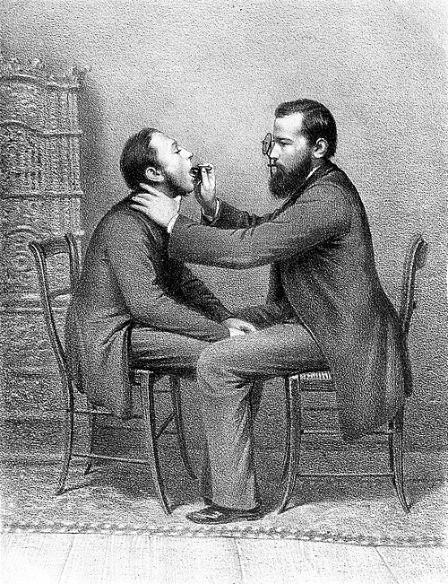
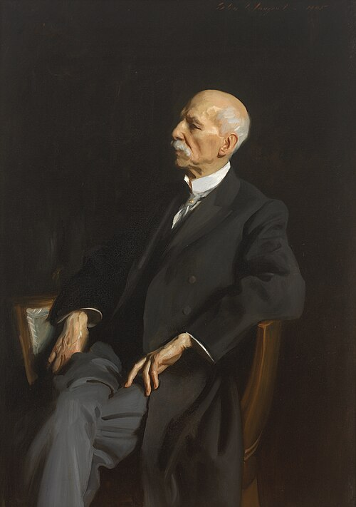

One day in September 1854, as he told the story decades later, the singing teacher **[Manuel García](kloom:e/manuel-garcia-baritone)** was walking in the Palais Royal in Paris when he saw how he might watch his own voice being made. He went to Charrière, the surgical instrument maker, and asked for a small mirror on a long handle. He was sold a dentist's mirror, "one of the failures of the London Exhibition of 1851," for six francs. At home he warmed it in water so that his breath would not fog it, set it against his uvula, and with a hand mirror threw a beam of sunlight onto it. At the first try he saw the glottis, the opening between the **[vocal folds](kloom:e/vocal-cords)**, wide open, and below it a little of the windpipe. He was so astonished, his pupil and biographer Malcolm Sterling Mackinlay wrote, that he sat down for several minutes before he looked again and watched the folds move as he sang.

## A teacher who wanted to see

García was born in Spain on 17 March 1805, the son of the tenor Manuel García, for whom Rossini wrote the part of Almaviva, and the brother of two famous singers, Maria Malibran and Pauline Viardot. He gave up the stage young and taught: at the Paris Conservatoire from 1830, then in London, at the Royal Academy of Music, from 1848. His pupils included **[Jenny Lind](kloom:e/jenny-lind)**, whose worn voice he rebuilt, and **[Mathilde Marchesi](kloom:e/mathilde-marchesi)**, who would teach a generation of singers herself. For years he had theorized about how the voice works without being able to look. "One wish was ever uppermost in my mind," he said: "if only I could see the glottis!"

Others had tried. Mackinlay's list runs from Bozzini of Frankfurt, who looked into the throat by reflected light in 1807, through Cagniard de Latour, who tried sunlight and two mirrors in 1825 and saw nothing, to Babington in London in 1829 and Avery in 1844, with a mirror and a lamp. García had heard of none of them. What was new was that a singer looked at a healthy larynx while it sang.

## Observations on the Human Voice

García sent his account to the **[Royal Society](kloom:e/royal-society)** on 22 March 1855, and it was read on 24 May. It begins with the method, the plate's geometry in words: "It consists in placing a little mirror, fixed on a long handle suitably bent, in the throat of the person experimented on against the soft palate and uvula. The party ought to turn himself towards the sun, so that the luminous rays falling on the little mirror, may be reflected on the larynx. If the observer experiment on himself, he ought, by means of a second mirror, to receive the rays of the sun, and direct them on the mirror, which is placed against the uvula."

Then he describes what he saw as he sang up and down his voice:

| What García sang                   | What he saw                                                                                               |
| ---------------------------------- | --------------------------------------------------------------------------------------------------------- |
| A deep breath                      | The cartilages at the back spring apart; the glottis opens wide, showing the rings of the windpipe        |
| Low, soft notes of the chest voice | "Large and loose vibrations" along the whole length of the glottis                                        |
| Rising in the chest voice          | The back of the opening closes up, so a shorter length vibrates, until only the ligaments themselves move |
| Full, loud notes                   | The cavity above contracts and hides the glottis                                                          |
| Falsetto                           | Longer, looser vibrations that leave the glottis half open, "a great waste of air"                        |

From this he drew his theory: the folds alone make the sound, by "the compressions and expansions of the air, or the successive and regular explosions which it produces in passing through the glottis." Air pressure pushes the closed folds apart, they spring together again, and the stream of puffs is the tone; the throat above shapes it. He acknowledged that **[Johannes Peter Müller](kloom:e/johannes-peter-muller)** in Berlin had already shown that the lower ligaments make the voice, though he disagreed with Müller's theory of how.

## From the singing room to the clinic

García wanted only to check his ideas, and the doctors were slow to see what he had made. In Vienna the neurologist **[Ludwig Türck](kloom:e/ludwig-turck)** began examining patients with throat mirrors in 1857 and gave up for want of sunlight in winter. The physiologist **[Johann Nepomuk Czermak](kloom:e/johann-nepomuk-czermak)**, shown Türck's mirrors, lit them with a lamp and a concave mirror on his own forehead, wrote a book on the method in 1860, and toured Europe demonstrating on his own throat. The two quarreled bitterly over priority. "If Garcia was the founder," Mackinlay wrote, "Czermak was the apostle." Within a few years **[laryngoscopy](kloom:e/laryngoscopy)** was a branch of medicine: doctors could now see growths, paralyzed folds and tuberculosis of the larynx in the living patient, and operate there.

## A hundred and one

García taught at the Royal Academy of Music until 1895, when he was ninety, and at home after that. On his hundredth birthday, 17 March 1905, laryngologists from around the world honored him as the father of their specialty; **[John Singer Sargent](kloom:e/john-singer-sargent)** painted him that year. He died in London on 1 July 1906, at a hundred and one. The trail turns next to the instrument that changed what a singer's voice had to do: the microphone.

