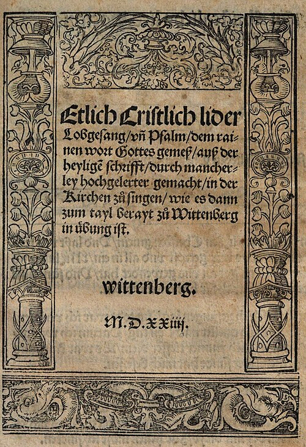
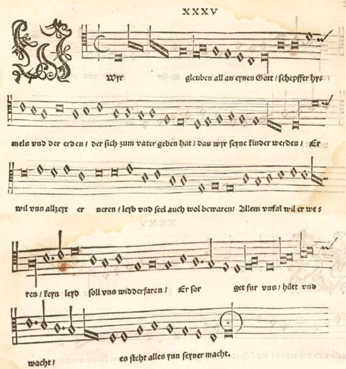

In 1524 three little books of German songs came off the presses within months of one another, and with them a new kind of church music. In the old Mass a trained choir sang Latin to a congregation that listened. **[Martin Luther](kloom:e/martin-luther)** wanted the congregation to sing, in German, and to understand what it sang. "I really believe, nor am I ashamed to assert," he wrote from Coburg in 1530 to **[Ludwig Senfl](kloom:e/ludwig-senfl)**, composer to the Bavarian court at Munich, "that next to theology there is no art equal to music, for it is the only one, except theology, which can give a quiet and happy mind." That is Preserved Smith's English of 1914; Luther used the phrase "next to theology" in his table talk too.

## Three books of 1524

The songs first went about as broadsheets, single printed sheets sold cheaply, which carried the **[Reformation](kloom:e/reformation)**'s ideas as cheap print had carried Luther's arguments since his _Ninety-five Theses_ of 1517. The earliest collection, usually called the **[_Achtliederbuch_](kloom:e/first-lutheran-hymnal)**, the eight-song book, is twelve pages long. Its title page names **[Wittenberg](kloom:e/wittenberg)** as the place of printing and promises songs "to be sung in church, as already practised in part" there, but it was printed in Nuremberg by Jobst Gutknecht around the turn of 1523 and 1524. Four of the eight songs are Luther's and three are by Paul Speratus, sung to five tunes. Demand was such that two Erfurt printers, Johannes Loersfeld and Matthes Maler, brought out rival editions of a larger book the same year, the **[Erfurt Enchiridion](kloom:e/erfurt-enchiridion)**, a "handbook" meant to be carried and sung at home, at court and in guild meetings as well as in church.

| Book, 1524                    | Printed                                 | Songs                  | For                   |
| ----------------------------- | --------------------------------------- | ---------------------- | --------------------- |
| _Achtliederbuch_              | Nuremberg, Jobst Gutknecht              | 8, on 5 tunes          | the congregation      |
| _Erfurt Enchiridion_          | Erfurt, Loersfeld and Maler, rival eds. | 25 or 26, 18 by Luther | home, court and guild |
| _Geystliche gesangk Buchleyn_ | Wittenberg, edited by Johann Walter     | 32, 24 by Luther       | the choir             |

## What a chorale is

The congregation sang the tune alone, without harmony. Each song is strophic: every stanza goes to the same melody, mostly one note to a syllable, in short lines. Many tunes were old. Luther turned Latin hymns into German and kept their melodies: the Advent hymn _Veni redemptor gentium_, credited to Ambrose, became _Nun komm, der Heiden Heiland_. Such a German hymn was called a spiritual song or a psalm in Luther's day. Only later in the century did the word **[chorale](kloom:e/chorale)**, which had meant Latin plainchant, pass to it.

The best known of them is **[_Ein feste Burg ist unser Gott_](kloom:e/a-mighty-fortress-is-our-god)**, "A mighty fortress is our God," a free paraphrase of Psalm 46 written between 1527 and 1529; the oldest surviving print is of 1531. Its melody in its first form, which Johannes Zahn printed in 1891 from Joseph Klug's Wittenberg hymnal of 1535, opens on three repeated Fs, drops a fourth to C on "Burg," climbs back through D to F on "un-" and sinks a step at a time, E, D, to C on "Gott": the plate draws it. The rhythm is free, with long notes on the strong syllables; the even version in equal notes that most churches sing came later. The Library of Congress holds a Victor disc made in Camden, New Jersey, on February 5, 1908, on which the Trinity Choir, a mixed quartet with orchestra, sings the hymn in English. Who wrote the tune is argued. Preserved Smith wrote in 1914 that the legend of Luther composing his tunes "has been exposed"; the article on the hymn in Wikipedia gives the present consensus, that Luther did write this one.

## A choir book from Wittenberg

The third book was for trained singers. **[Johann Walter](kloom:e/johann-walter)**, born in 1496 and a bass in the chapel of Frederick the Wise of Saxony, set the songs for three to five voices with the hymn tune in the tenor, and published them in partbooks as the **[_Geystliche gesangk Buchleyn_](kloom:e/eyn-geystlich-gesangk-buchleyn)**. Luther's preface, in Leonard Woolsey Bacon's translation of 1883, says the songs "have been set in four parts, for no other reason than because I wished to provide our young people … with something whereby they might rid themselves of amorous and carnal songs." Walter remembered in old age that Luther, setting up a German Mass, had kept him three weeks in Wittenberg writing notes over the Gospels and Epistles, and had told him that he learned from Virgil to fit words to story, "in like manner must Music govern all its notes and melodies by the text."

## Geneva sang psalms

**[John Calvin](kloom:e/john-calvin)** in **[Geneva](kloom:e/geneva)** went further toward plainness. His churches sang the psalms and a few canticles, put into French verse by Clément Marot and Théodore de Bèze, in unison and unaccompanied; Dutch Reformed churches that used them had neither choir nor organ. The **[Genevan Psalter](kloom:e/genevan-psalter)**, begun at Strasbourg in 1539, was complete in 1562 with all 150 psalms on 124 tunes, in two note values. Harmonized settings, such as Claude Goudimel's, were sung at home.

In Lutheran churches the chorales stayed and the choir stayed beside them. Two centuries later **[Johann Sebastian Bach](kloom:e/johann-sebastian-bach)** built a cantata on _Ein feste Burg_ and harmonized hundreds of chorales, with the tune the congregation knew in the top voice. He is the Bach of _The Well-Tempered Clavier_, later in this subject. In Rome, meanwhile, the Catholic Church was asking what its own choirs should sound like.
