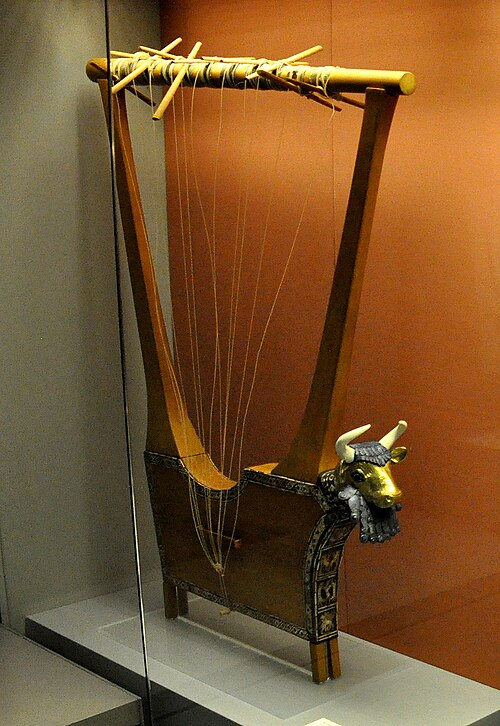

In the winter of 1928–29 the archaeologist **[Leonard Woolley](kloom:e/leonard-woolley)**, digging at **[Ur](kloom:e/ur)** in southern Iraq for a joint expedition of the **[British Museum](kloom:e/british-museum)** and the University of Pennsylvania's museum, came down twenty-six feet through the mound to a pit about 27 feet by 24, smoothly plastered with mud. On its floor lay six men and sixty-eight women, the women in rows, "every one lying on her side with legs slightly bent and hands brought up near the face." It was the largest of the death pits in the **[Royal Cemetery at Ur](kloom:e/royal-cemetery-at-ur)**, and with them were four instruments. Woolley called it the Great Death Pit. The burials are from about 2550 to 2450 BC, **[Sumer](kloom:e/sumer)** in its Early Dynastic period, and the **[Lyres of Ur](kloom:e/lyres-of-ur)** are the oldest stringed instruments to survive.

## Four lyres in one pit

Woolley described the finest in his popular account, _Ur of the Chaldees_ (1929): "its sounding-box was bordered with a broad edging of mosaic in red and white and blue, the two uprights were encrusted with shell and lapis lazuli and red stone arranged in zones separated by wide gold bands," and from its front "projected a splendid head of a bearded bull wrought in heavy gold." A second was "all of silver with a silver cow's head." A third, of silver too, was shaped as a high-prowed boat with a stag standing on it; the fourth had decayed almost to nothing.

They are box lyres: two arms rise from a hollow sound box to a crossbar, and the strings run from the bar down across the face of the box, where a harp's rise from the box itself to an arm. The shape of the box, Woolley noticed, is the animal's body, "resolved almost entirely into straight lines": the head projects from its front.

| Instrument, in Woolley's report of 1934 | Head           | Strings            | Now                       |
| --------------------------------------- | -------------- | ------------------ | ------------------------- |
| Gold lyre, Great Death Pit              | Bearded bull   | probably 8         | Iraq Museum, Baghdad      |
| Silver lyre, Great Death Pit            | Cow            | 11                 | British Museum            |
| Boat lyre, Great Death Pit              | Stag           | 11 (he queried it) | Penn Museum               |
| Puabi's instrument, grave PG 800        | Calf, he wrote | 11 (as a harp)     | British Museum, as a lyre |

## Lifted in plaster

The wood had rotted away, and only the gold, silver, shell and stone of the decoration held their places in the soil. In the grave of Queen **[Puabi](kloom:e/puabi)** (Woolley read her name Shub-ad), the diggers found gold-headed nails still fixed in a hole in the earth. They pushed a stick down it and poured plaster of Paris around it, and when the plaster set they dug down to the lower part of the upright, cast in plaster with the nails still in it; the spacing of the nails gave its full height. Loose inlay was waxed and backed with muslin as it came to light. Beside the instrument lay ten women, and one lay against it; in Woolley's words of 1929, "across the ruins of the harp lay the bones of the gold-crowned harpist."

Woolley restored Puabi's instrument as a harp. On 1 July 1961 heat built up in its gallery and melted the wax of the field restoration, and in 1971–72 the British Museum's conservators rebuilt it, from part of his harp, as the lyre now called the **Queen's Lyre**, 112.5 centimeters high, with eleven gold-headed pegs. Its gold bull's head and inlaid panels are ancient; the wood, the pegs, the strings and the horns are modern.

## The people buried with them

Woolley thought the attendants of the dead were "persons held in honour, wearing their robes of office," who came to the pit, "one hopes, voluntarily"; in the story as it was long told, they took poison and lay down. In 2011 Aubrey Baadsgaard and colleagues at the **[Penn Museum](kloom:e/penn-museum)** examined two of the cemetery's skulls by CT scan and proposed something less gentle: the victims were struck down with a sharp instrument, then heated, treated with mercury, dressed and laid in their rows.

## Bull, cow and calf

Woolley wondered whether the animals told the instruments' voices. A thousand years later the ruler **[Gudea](kloom:e/gudea)** of Lagash wrote of a harp given to a temple whose sound was like a bull's bellow; might the bull, the cow and the calf on the lyres of Ur, he asked, mark bass, tenor and alto, "a knowledge of harmony very surprising at so early a date"? It was a guess he could not test, for the strings and the music were gone.

The gold lyre had a last misfortune: its rebuilt wooden body was damaged by flooding in the Iraq Museum during the war of 2003. A playable copy, made with the help of engineers at the University of Liverpool in 2005, has been played on tour since. What the women of Ur played on their lyres is not known. The oldest music we can read was written down about a thousand years later, for a lyre, at Ugarit.
