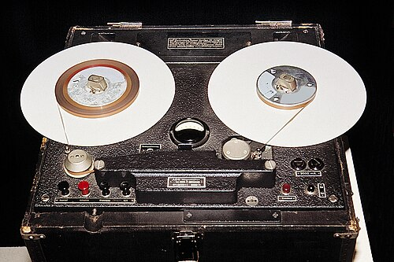

In 1944 an American Signal Corps engineer working late in England, **[Jack Mullin](kloom:e/jack-mullin)**, tuned across the dial after the BBC went off the air at midnight and found German stations playing symphony concerts all night long. They had none of the surface noise and four-minute breaks of a 78, and a movement might run a quarter of an hour without a pause. He doubted, he wrote later, that even Hitler could have orchestras playing live night after night. The music came from **[magnetic tape](kloom:e/magnetic-tape)**: from the **[Magnetophon](kloom:e/magnetophon)**, and from a trick of physics found in a Berlin broadcasting laboratory four years before.

## Wire, steel and powder

Recording sound as magnetism was older than the electrical gramophone. In 1898 the Danish engineer **[Valdemar Poulsen](kloom:e/valdemar-poulsen)** patented his telegraphone, which magnetized a steel wire as it ran past an electromagnet, but before the vacuum tube there was nothing to make its faint playback loud. Later machines used steel tape: the BBC's of 1935 ran a ribbon three millimeters wide at a meter and a half a second, thirty minutes to a nine-kilogram reel, which could spring apart like a watch spring and could be edited only by welding. In 1928 the German engineer **[Fritz Pfleumer](kloom:e/fritz-pfleumer)** patented a strip of paper glued with iron powder.

The electrical company **[AEG](kloom:e/aeg-german-company)** in Berlin took up Pfleumer's idea and asked the chemists of **[BASF](kloom:e/basf)** to make the tape. They coated a cellulose acetate film 30 micrometers thick with 20 micrometers of fine iron powder, slit it 6.5 millimeters wide and ran it at a meter a second. The AEG Magnetophon and its tape were first shown at the Berlin Radio Exhibition in August 1935, where a fire burned down the hall and AEG built two more machines to show in a makeshift booth before the end. A recorder cost 1,350 Reichsmarks, more than five months' pay for a trained technician. It was not yet good. Even after BASF changed to iron oxide, first black magnetite and in 1939 the red gamma oxide that tape used for thirty years, it reached only 50 to 5,000 hertz with heavy hiss and distortion.

## The bias

The fault lay in the oxide. A weak field barely magnetizes it, so quiet sounds were lost and loud ones bent out of shape. A steady direct current added to the signal helped a little and left a hiss of its own. In about April 1940, at the **[Reichs-Rundfunk-Gesellschaft](kloom:e/reichs-rundfunk-gesellschaft)**, the broadcaster that [Nazi Germany](kloom:e/nazi-germany) had used for propaganda since 1933, the engineer **[Walter Weber](kloom:e/walter-weber-engineer)** was trying to cut the noise with negative feedback when his test circuit broke into oscillation, and the noise fell. Mixing a high-frequency tone with the signal at the recording head proved to be the cure.

| Step | What happens                                                                                                                                                       |
| ---- | ------------------------------------------------------------------------------------------------------------------------------------------------------------------ |
| 1    | The signal and a strong inaudible tone, tens of thousands of cycles a second, flow together through the recording head's coil.                                     |
| 2    | In the head's gap the tone swings each patch of oxide back and forth through its whole range of magnetism.                                                         |
| 3    | As the tape leaves the gap the swings die away, and each patch settles magnetized in proportion to the audio signal alone.                                         |
| 4    | On playback the moving tape's magnetism induces a current in the playback head's coil, as Faraday's moving magnet did, and the recording comes back in proportion. |

AEG showed the result in a Berlin cinema in June 1941: by the figures of the day, 50 to 10,000 hertz and a range of 60 decibels between the loudest sound and the hiss. Weber did not invent the idea. Wendell Carlson and Glenn Carpenter had patented high-frequency bias in the United States in 1927, and three Japanese engineers in 1940; Friedrich Engel, the historian of BASF's tape, credits Weber with putting it into practice. Through the war the regime's radio broadcast taped music and speeches, and the post office used Magnetophons to listen in on telephone calls.

## Scissors and Scotch tape

In July 1945 Mullin stopped at a radio station in a castle at Bad Nauheim, north of Frankfurt, and asked to hear its Magnetophon. "I couldn't tell from the sound whether it was live or playback," he wrote. He mailed two machines home to San Francisco in pieces, small enough for mailbags, with fifty reels of German tape, and rebuilt their electronics with American parts. In June 1947 he played them for **[Bing Crosby](kloom:e/bing-crosby)**, whose network, NBC, had refused to broadcast a recorded show. Crosby's new sponsor, Philco, let him record on discs for ABC, but copying from disc to disc wore his voice thin. Mullin taped the first show of the 1947–48 season as a test, aired on 1 October, and Crosby hired him.

Mullin cut the shows with scissors and joined them with ordinary mending tape, dusting each splice with talcum powder so the reels would not stick, and made twenty-six shows from his fifty reels. Song takes from the afternoon rehearsal replaced fluffs in the evening's, and the laughs from one show were spliced into a later one. Crosby put $50,000 behind the little firm of **[Ampex](kloom:e/ampex)**, whose Model 200 recorders, copied from the Magnetophon, reached Mullin in April 1948: an investment in one account, an order for machines in another.

Tape could be cut, and it could be layered. Crosby gave the guitarist **[Les Paul](kloom:e/les-paul)**, whose solid-body guitar is the electric guitar's story, an Ampex, and Paul added a second playback head so that he could play along with what he had just recorded and put both on tape again; in the 1950s he paid Ampex $10,000 for one of the first eight-track machines. In Paris in 1948 **[Pierre Schaeffer](kloom:e/pierre-schaeffer)** began composing from recorded sounds, at first on phonograph discs, and turned to tape in 1951. In 1963 Philips showed the compact cassette at the same Berlin radio show that had first seen the Magnetophon. Tape now held the music before it went onto disc, and soon the disc itself would grow long.
