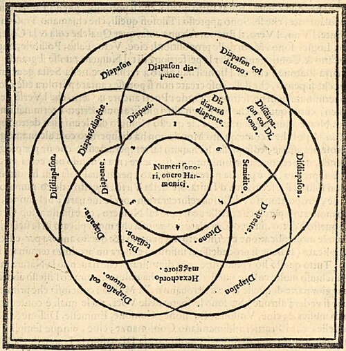

In 1523 a priest and church singer born in Florence, **[Pietro Aron](kloom:e/pietro-aron)**, published in **[Venice](kloom:e/venice)** a book in Italian for working musicians, the _Toscanello in musica_. In it he told players how to tune a keyboard, and the instructions began in a new place: tune the third C to E pure, and make the fifth C to G a little flat to fit it. By the next century this was the standard keyboard tuning of Europe, later called **[meantone temperament](kloom:e/meantone-temperament)**: every fifth narrowed a hair, so that the thirds would ring.

## Why the thirds mattered

The old tuning built every note from pure fifths of 3:2. That gives a third of 81:64, as Ptolemy had shown, and medieval music could live with it, since it treated thirds as unstable sounds and never ended on one. Polyphony of Aron's time was built on full chords, a third and a fifth over the bass, and the Pythagorean third in such a chord rattles. A pure third of 5:4 is smaller by 81:80, the **[syntonic comma](kloom:e/syntonic-comma)**. Four pure fifths stacked up overshoot a pure third by that comma, so the cure is to take a quarter of it from each fifth, and four narrowed fifths then land exactly on 5:4.

| Each fifth                   | Its ratio | Four fifths, less two octaves | That third beats, on middle C |
| ---------------------------- | --------- | ----------------------------- | ----------------------------- |
| Pure, Pythagorean            | 1.5000    | 81:64 = 1.2656                | about 16 times a second       |
| Quarter-comma meantone       | 1.4953    | 5:4 = 1.2500                  | not at all                    |
| Equal temperament, for later | 1.4983    | 1.2599                        | about 10 times a second       |

The numbers are by our arithmetic: the meantone fifth is the fourth root of 5. What is heard is a trade. On a meantone harpsichord the fifth C–G wavers slowly, about two and a half beats a second, and the third C–E, which in the old tuning buzzed, is smooth as glass. The whole tone between them, C–D, is exactly half the pure third, the mean of the two sizes of tone in **[just intonation](kloom:e/just-intonation)**, which gave the system its name.

## The wolf

The cost comes at the far side of the circle of fifths. A keyboard has twelve keys to the octave, and eleven narrow fifths do not close: the twelfth, from G♯ to E♭, is really a diminished sixth, at 1.5312 far too wide. The plate draws it as a gap. Played on G♯ below middle C it beats about thirteen times a second, by our arithmetic, and players called it the **[wolf fifth](kloom:e/wolf-interval)**. Alexander Ellis, Helmholtz's translator, wrote in 1885 that organists forced to use such chords produced a "horrible effect" that "was familiarly compared to the howling of 'wolves'." Keys with more than two flats or three sharps were out of reach, and thirds such as B to D♯ played on the E♭ key were nearly as bad.

Builders fought back by adding keys. Italian harpsichords often split the E♭ and G♯ keys in two, front and back, to give both D♯ and E♭, G♯ and A♭. **[Nicola Vicentino](kloom:e/nicola-vicentino)** went further: his **[archicembalo](kloom:e/archicembalo)**, described in 1555, had two manuals and thirty-six keys to the octave. Extended far enough, quarter-comma meantone comes within a hair of dividing the octave into thirty-one equal steps, and he is often said to have done just that; the historian Mark Lindley doubted it, since Vicentino wrote that some thirds of his second tuning were purer than those of the first.

## Who invented it?

Aron is now usually credited with the first description, though Wikipedia's own articles cannot agree whether he described quarter-comma meantone or only something like it. **[Gioseffo Zarlino](kloom:e/gioseffo-zarlino)**, maestro di cappella at St Mark's in Venice, put just intonation on a new footing in his _Le istitutioni harmoniche_ of 1558: every consonance comes from the numbers one to six, the _senario_, shown in the woodcut, so that 5:4 and 6:5 are as natural as 3:2. For keyboards he gave a temperament of two-sevenths of a comma, and in 1571 the quarter-comma too. **[Francisco de Salinas](kloom:e/francisco-de-salinas)**, blind from childhood and professor at Salamanca, set out three temperaments in _De musica libri septem_ in 1577, of a third, two-sevenths and a quarter of a comma, and claimed the first as his own. In Ellis's English: "The first, so far as I know, has been laid down by no one." Ellis, reading him three centuries later, gave the invention of meantone to Salinas and did not name Aron at all.

## How long it lasted

On organs, meantone lasted into the age of the railway. Ellis, who measured the pitches himself, recorded that it "disappeared from pianofortes in England between 1840 and 1846," and that at the **[Great Exhibition](kloom:e/great-exhibition)** of 1851 no English organ was tuned in equal temperament; the only one there that was came from Germany. The first English organ built in equal temperament was made in 1854. In 1880 Ellis still found meantone on three organs, at St George's Chapel, Windsor, at St Katharine's, Regent's Park, and at Kew, and generally in Spain.

The wolf was finally caged by giving up pure thirds altogether, a step a Ming prince had already computed, which the trail takes next.
