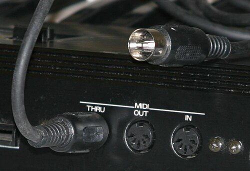

At the winter **[NAMM Show](kloom:e/namm-show)** in Anaheim, California, in January 1983, **[Dave Smith](kloom:e/dave-smith-engineer)** of **[Sequential Circuits](kloom:e/sequential-company)** ran a cable from his company's new Prophet-600 synthesizer to a **[Roland Jupiter-6](kloom:e/roland-jupiter-6)** at Roland's stand. Guards nearly kept him out, he remembered, because he had no pass, and nobody was sure the demonstration would work. It did. Two rival makers' keyboards were, in Roland's words, "enabled to 'talk' to one another", through a language neither of them owned. They called it **[MIDI](kloom:e/midi)**, the Musical Instrument Digital Interface. "You could play one keyboard with your right hand and another keyboard with your left hand," Smith said of the years before, "but [musicians] couldn't play more than one at the same time."

## Rivals agree

Every maker had its own wiring: control voltages and gates that rarely matched, and private buses for its own drum machines and sequencers. In June 1981 **[Ikutaro Kakehashi](kloom:e/ikutaro-kakehashi)**, the founder of **[Roland Corporation](kloom:e/roland-corporation)**, put the idea of one industry standard to **[Tom Oberheim](kloom:e/tom-oberheim)** at the summer NAMM show in Chicago, and Oberheim suggested he talk to Smith too. Smith and his engineer Chet Wood wrote a "Universal Synthesizer Interface" and presented it to the **[Audio Engineering Society](kloom:e/audio-engineering-society)** that October: serial data at 19.2 kilobaud through ordinary phone jacks, "a preliminary specification" that "has not been tested."

The Japanese makers, Roland, **[Yamaha](kloom:e/yamaha-corporation)**, Korg and Kawai, met about once a month to answer it, and much of MIDI is theirs. They asked for more speed and a five-pin DIN plug, which Roland already used to synchronize its TR-808 drum machine; Yamaha's engineers proposed an opto-isolator, a lamp and a light sensor in one sealed package, so that no two instruments shared an electrical ground to hum through; Roland's Tadao Kikumoto proposed separate status and data bytes. A meeting of makers at the winter NAMM show of 1982 agreed on nothing, the Americans and Europeans least of all, but Kakehashi sent word to Smith not to give up. "Universal Synthesizer Interface" raised worries about antitrust law; the Japanese makers suggested "Universal Music Interface," or UMI, and Smith offered the name that stuck. **[Robert Moog](kloom:e/robert-moog)** made it public in his _Keyboard_ column in October or November 1982 (the sources differ), and the first Prophet-600s with MIDI left the factory in December. The specification itself followed the Anaheim show: fourteen pages dated 5 August 1983, registered with the US Copyright Office by the International MIDI Association, though a British magazine that reprinted it in May 1984 called its copy "dated October 1983".

Nobody owned it. "We had to give it away," Smith said in 2012; "it would have been even more fun to have made some money off of it, if that were possible. But that wasn't part of the plan."

## A note in three bytes

MIDI carries no sound, only instructions. Each message is a status byte, its top bit 1, followed by one or two data bytes whose top bit is 0, so a value runs from 0 to 127. Pressing middle C at moderate strength on channel 1 sends three bytes, which the 1996 specification gives as its own example:

| Byte (hex) | Bits     | Means                                                |
| ---------- | -------- | ---------------------------------------------------- |
| 90         | 10010000 | Note On (1001), on channel 1 (0000, the first of 16) |
| 3C         | 00111100 | key 60, middle C                                     |
| 40         | 01000000 | velocity 64, mezzo-forte                             |

Lifting the key sends `80 3C 40`, Note Off, or the same Note On with a velocity of 0; after the first, a run of notes may leave the status byte out. The wire runs at 31,250 bits a second, each byte framed by a start and a stop bit, so a byte takes 320 microseconds and this message nearly a millisecond. A ten-note chord, sent with one status byte and twenty data bytes, arrives over 6.7 milliseconds by our arithmetic, the delay musicians call "MIDI slop" when too much is asked of one cable. The signal is a current of 5 milliamperes on pins 4 and 5, through an opto-isolator, on a cable of at most fifteen meters. The plate draws the socket and that Note On as it goes down the wire.

What a receiver plays is its own business. The same three bytes sound a grand piano on one instrument and a flute on another.

## The studio at home

"What MIDI did is it allowed the first home studios to be born," Smith said. The **[Atari ST](kloom:e/atari-st)**, sold from 1985, had MIDI sockets built in, and on it ran sequencers that grew into Cubase and Logic, which record, edit and replay a performance as messages rather than sound. Alex Paterson of the Orb recalled making "Little Fluffy Clouds" in 1990 with synthesizers that all played from what was stored in one sequence: "It was like walking into a dream."

**[General MIDI](kloom:e/general-midi)**, published in 1991, fixed what the numbers meant: program 1 is an acoustic grand piano, 41 a violin, channel 10 the drums, and a compliant instrument plays at least 24 notes at once. A General MIDI file therefore sounds much the same anywhere, and small enough to fit, it scored computer games on floppy disks and played as early mobile phones' ringtones.

On 9 February 2013 the Recording Academy gave Kakehashi and Smith a Technical Grammy for MIDI; Kakehashi's son accepted it for him. In February 2020 the first specifications of MIDI 2.0 were released: velocity in 16 bits and controllers in 32, in packets, with every MIDI 1.0 message still carried inside them. MIDI sent instructions; the MP3 would soon send the sound itself, squeezed.
