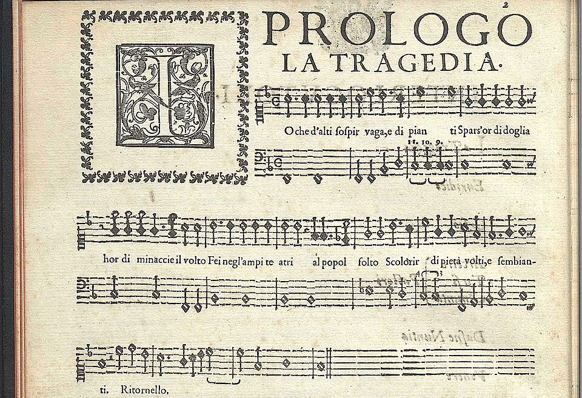
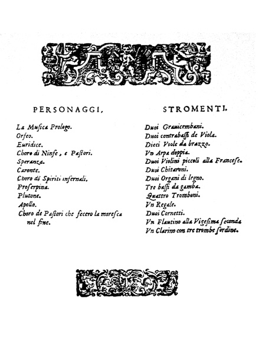

On 23 February 1607 a court official at **[Mantua](kloom:e/mantua)** wrote that the next evening Prince Francesco Gonzaga would present a play in rooms of the Ducal Palace, and that it should be "most unusual, as all the actors are to sing their parts." The play was **[_L'Orfeo_](kloom:e/lorfeo)**, a "fable in music" by the court's master of music, **[Claudio Monteverdi](kloom:e/claudio-monteverdi)**, to a libretto by Alessandro Striggio: the story of Orpheus, whose singing moved the gods of the dead. It was sung on 24 February. Some roles were sung by castrati, one of them borrowed from the Medici court in [Florence](kloom:e/florence). Monteverdi did not invent the form, but his is the earliest **[opera](kloom:e/opera)** still regularly performed.

## Speech in song

The idea came from Florence too. From 1573 the **[Florentine Camerata](kloom:e/florentine-camerata)**, a circle of humanists, poets and musicians, met at Count Giovanni de' Bardi's house there. Persuaded above all by the scholar Girolamo Mei that the ancient Greeks had sung their tragedies throughout, they blamed the polyphony of their own day for burying the words: one voice should sing them clearly over a plain accompaniment. The composer **[Vincenzo Galilei](kloom:e/vincenzo-galilei)**, the astronomer's father, was one of them.

The singer **[Jacopo Peri](kloom:e/jacopo-peri)**, working with the poet Ottavio Rinuccini for Bardi's rival patron Jacopo Corsi, set Rinuccini's _Dafne_ that way; it was sung in 1598 and is lost. Their **[_Euridice_](kloom:e/euridice-peri)**, sung at the Pitti Palace on 6 October 1600 for a royal wedding, with Peri himself as Orpheus, is the earliest opera whose music survives. Duke Vincenzo Gonzaga of Mantua was in the audience. **[Giulio Caccini](kloom:e/giulio-caccini)**, who had supplied some of its songs, hurried his own setting of the same libretto into print before Peri's appeared. Peri's preface says what he was after, in our translation:

> I judged that the ancient Greeks and Romans, who in the opinion of many sang whole tragedies on the stage, used a harmony that, rising above that of ordinary speech, fell so far below the melody of song as to take a form in between.

He listened for the syllables a speaker stresses and "made the bass move in time with these, now more, now less, according to the passions," holding it still through dissonance and consonance alike "until the voice of the one speaking, running over various notes, reached one" that opens the way to a new chord.

## A voice over a bass

That is **recitative**, and its accompaniment is the **[basso continuo](kloom:e/basso-continuo)**. The printed page gives only two lines: the voice, and a bass. Numbers over the bass, its figures, tell a harpsichord, lute or organ player which notes to add, counted up from the bass note; the player improvises the chord. Peri's prologue counts past the octave, asking for an eleventh, a tenth and a ninth in turn. The table's bass is always C, our own example:

| Figure    | Notes above the bass                      | Over C          |
| --------- | ----------------------------------------- | --------------- |
| none      | a third and a fifth                       | E, G            |
| 6         | a third and a sixth                       | E, A            |
| 6 over 4  | a fourth and a sixth                      | F, A            |
| 4, then 3 | a fourth that falls to the third          | F to E, with G  |
| 7         | a seventh, with the third and fifth       | E, G, B         |
| 11, 10, 9 | a fourth, a third, a second, an octave up | F, E, D, higher |

The plate stacks each chord of a short figured bass above its note.

## Thirty-six instruments

Monteverdi printed the score in [Venice](kloom:e/venice) in 1609 with a list of the instruments. By our count it names 36: two harpsichords, ten _viole da brazzo_ (the violin family), three bass viols, two double basses, a double harp, two little French violins, two chitarroni (long-necked lutes), two wooden organs, four trombones, a regal (a small reed organ), two cornetts, a little recorder, and a high trumpet with three muted ones. Directions later in the score add a third chitarrone, a fifth trombone and a second recorder, so Wikipedia's article, following Jane Glover, counts about 41.

Before the curtain rises a brassy fanfare, the toccata, is played three times, "a tone higher" if the trumpets are muted. The fields of Thrace get strings, harpsichords and recorders; Charon the ferryman sings to the snarl of the regal. The center of the opera is Orpheus's plea to him in Act 3, **"[Possente spirto](kloom:e/possente-spirto)"**. Over a bass that holds one low note for bars at a time, played on a wooden organ and a chitarrone, the score prints the voice twice and says that Orpheus "sings only one of the two parts." One line is plain; in the other the same notes break into dotted figures and runs of quick notes on single syllables. Between the verses two violins answer him, then two cornetts, then the double harp. Some scholars take the two versions as a sample of what singers did everywhere; the conductor Nikolaus Harnoncourt held that where Monteverdi wrote no ornaments he wanted none.

The 1607 libretto ends with Bacchantes threatening Orpheus, the 1609 score with Apollo carrying him to heaven; Nino Pirrotta argued that Apollo was always planned but the small room could not hold the machinery. A Victor disc recorded on 17 December 1914 carries the baritone Reinald Werrenrath singing Orpheus's lament, "Tu se' morta."

## Opera for a paying public

Monteverdi moved to St Mark's in Venice in 1613. In 1637 the Tron family opened the **[Teatro San Cassiano](kloom:e/teatro-san-cassiano)** there as a theater for music, and opera, until then a court entertainment, was sold to anyone with a ticket; a notary's record of 1657 says it once had 153 boxes. Of the three operas Monteverdi wrote for the new stages, two survive, _Il ritorno d'Ulisse in patria_ (1640) and _L'incoronazione di Poppea_ (1643).

The trail that branches here follows the voice as an instrument: the castrati, a soprano's American tour, the mirror that first saw the vocal folds, the microphone and Auto-Tune. Monteverdi was born in Cremona, the town of the violin makers.
