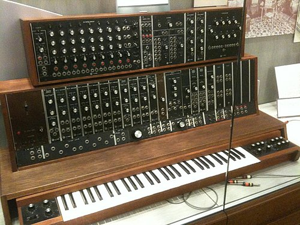

In October 1964 a thirty-year-old engineer, **[Robert Moog](kloom:e/robert-moog)**, brought a few small boxes of electronics to the convention of the Audio Engineering Society in New York. Moog was finishing a doctorate in engineering physics at Cornell and ran a small business from Trumansburg, New York, selling **[theremin](kloom:e/theremin)** kits by mail. His boxes were modules, each doing one job: an oscillator that made a tone, an amplifier that made it louder or softer. He had not planned to sell any, but orders came at the show, and the choreographer Alwin Nikolais bought the first. Moog's paper, "Voltage-Controlled Electronic Music Modules," was printed in the society's journal in July 1965. Within four years his instrument, the **[Moog synthesizer](kloom:e/moog-synthesizer)**, was on a record in the Billboard top ten, playing Bach.

## Before Moog

Electronic instruments were not new. The theremin, which Leon Theremin built in Russia in 1920, is played without touching it: one hand's distance from an antenna sets the pitch, the other's from a second antenna the loudness, and it sings in a gliding, wavering tone. At the other extreme stood the **[RCA Mark II Sound Synthesizer](kloom:e/rca-mark-ii-sound-synthesizer)**, designed by **[Harry F. Olson](kloom:e/harry-f-olson)** and Herbert Belar and installed at the Columbia–Princeton Electronic Music Center in 1957: a wall of vacuum tubes, fed its music on a punched paper roll, which composers could program but not play.

## Music by voltage

Moog's idea was to make every setting a voltage, so that one module could set another. He found it in the silicon **[bipolar junction transistor](kloom:e/bipolar-junction-transistor)**, whose collector current rises exponentially with the voltage at its base. Pitch works the same way: each octave doubles the frequency. So in Moog's oscillator, one more volt at the input meant one octave up, and a twelfth of a volt one equal-tempered semitone. A keyboard simply sent those voltages, and the same voltage could come instead from a pedal, a ribbon or another oscillator. A slow oscillator sweeping a fast one's pitch gave vibrato. Here, with an invented starting point, is what the standard means:

| Control voltage | Pitch             | Frequency |
| --------------- | ----------------- | --------- |
| 0 V             | A                 | 110 Hz    |
| 1/12 V          | A sharp           | 116.5 Hz  |
| 1 V             | A, an octave up   | 220 Hz    |
| 2 V             | A, two octaves up | 440 Hz    |

Nothing sounded until the modules were joined with patch cords, and the plate draws the simplest patch:

| Module             | Job                                                                                |
| ------------------ | ---------------------------------------------------------------------------------- |
| Oscillator (VCO)   | Makes the tone: a sawtooth, triangle, pulse or sine wave, its pitch set by voltage |
| Filter (VCF)       | Takes away the upper harmonics above a cutoff that voltage sets                    |
| Amplifier (VCA)    | Sets loudness by voltage                                                           |
| Envelope generator | When a key is pressed, makes a voltage that rises and falls, to shape a note       |
| Keyboard           | Sends a pitch voltage and a signal that a key is down                              |

By Fourier's series, a sawtooth wave is the sum of sine waves at every whole multiple of its frequency, the *n*th at 1/_n_ the strength of the first, which is why it sounds, in one description, "bright, full, brassy." The filter subtracts. Moog's patent of 1969, the only one he took on the instrument, covers it: pairs of transistors joined by capacitors, rung above rung like a ladder, whose cutoff the control voltage moves. Each of its four stages takes away 6 decibels an octave, 24 in all, and feeding the output back to the input makes it ring at the cutoff, as the plate's computed curves show. Patch an envelope to the filter and the amplifier and press a key, and the note opens from dark to bright and closes again. The filter's sound, called "rich," "juicy" and "fat," became the Moog's signature.

## Switched-On Bach

**[Wendy Carlos](kloom:e/wendy-carlos)** met Moog at the same 1964 convention. A composer trained at the Columbia–Princeton center and a recording engineer, she gave him detailed criticism of every module, and the touch-sensitive keyboard and portamento were her suggestions. With the producer Rachel Elkind and the musicologist Benjamin Folkman she spent about five months, by her count more than a thousand hours, recording **[_Switched-On Bach_](kloom:e/switched-on-bach)** at home. The Moog played one note at a time, so every line of each piece was recorded separately on an eight-track recorder Carlos had built herself, and the oscillators drifted out of tune after a measure or two. The album opens with the Sinfonia to Cantata no. 29, includes two preludes and fugues from **[_The Well-Tempered Clavier_](kloom:e/the-well-tempered-clavier)**, and ends with the whole Third Brandenburg Concerto. Carlos later heard its charm in "inexact tunings and several finger-slips notwithstanding." For that concerto's slow movement, where **[Johann Sebastian Bach](kloom:e/johann-sebastian-bach)** left only two chords for the players to improvise on, Carlos and Folkman wrote a passage of their own.

**[Columbia Records](kloom:e/columbia-records)** released it in October 1968. It reached number ten on the Billboard album chart, topped the classical chart from January 1969 to January 1972, won three Grammy Awards in 1970, and passed a million copies by June 1974. Its advance had been $1,000 by Elkind's memory, about $2,500 by Carlos's.

Carlos had begun her transition early in 1968, before the album appeared, and its success frightened her: for her few public appearances she disguised herself to match the name on the sleeve. She spoke publicly about being transgender in interviews published in 1979. "The public turned out to be amazingly tolerant or, if you wish, indifferent," she said in 1985; the secrecy "had proven a monstrous waste of years of my life."

## To the stage

Across the country, in California, the engineer **[Don Buchla](kloom:e/don-buchla)** had built modules of his own for the San Francisco Tape Music Center from 1963, played from touch plates rather than a keyboard, which he thought restrictive. Moog's engineers built the **[Minimoog](kloom:e/minimoog)** in 1970, a whole **[synthesizer](kloom:e/synthesizer)** in one case, its modules wired together with no patch cords: the first sold in music shops, and more than 12,000 were made by 1981. The voltages would give way to numbers within a decade, beginning with John Chowning's FM synthesis.
