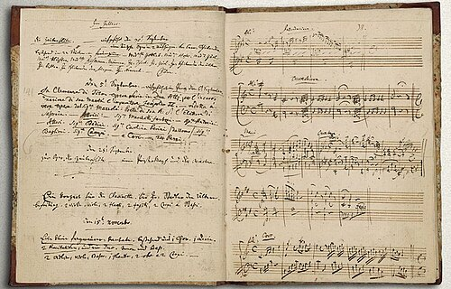

In March 1781 the twenty-five-year-old **[Wolfgang Amadeus Mozart](kloom:e/wolfgang-amadeus-mozart)** was summoned to **[Vienna](kloom:e/vienna)** by his employer, **[Hieronymus von Colloredo](kloom:e/hieronymus-von-colloredo)**, the Prince-Archbishop of **[Salzburg](kloom:e/salzburg)**. At the archbishop's table, Mozart wrote home, "the two valets sit at the head of the table. I have, at all events, the honor to be placed above the cooks." Count Arco, the archbishop's steward, would not pass on his petitions to leave. On 9 June Mozart wrote to his father, **[Leopold Mozart](kloom:e/leopold-mozart)**, that Arco, rather than let him see the archbishop, "throws him out of the door and gives him a kick in the behind" (in our translation; Lady Wallace's English of 1866 made it "turn me out of doors with a kick"). He stayed in Vienna, with no post and no salary.

## Pupils, princes and tickets

A freelance lived on pupils, noble patrons, concerts at his own risk, and fees from publishers and theaters. On 24 December 1781 Mozart played against the visiting virtuoso **[Muzio Clementi](kloom:e/muzio-clementi)** before Emperor **[Joseph II](kloom:e/joseph-ii)** and his Russian guests, the Grand Duke Paul and his wife, the visit for which the emperor had also had Kempelen's chess-playing Turk rebuilt. The emperor sent Mozart fifty ducats, "which I at present stand greatly in need of"; Clementi, Mozart told his father, was "a mere machine."

By Lent 1784 he was rarely free. On 3 March he sent his father a list of the twenty-two engagements he was booked for between 26 February and 3 April: fourteen at the houses of Count Johann Esterházy and the Russian ambassador, Prince Golitsyn, three in the Saturday series of the piano teacher Richter, two "academies" in the theater, and three subscription concerts of his own in the hall of the Trattnerhof, at six florins for the three. "Have I not enough to do?" By 20 March he had 174 subscribers, he wrote, "thirty more than Richter and Fischer together."

| What Mozart was paid, or paid                    | Amount                       |
| ------------------------------------------------ | ---------------------------- |
| His salary as court organist in Salzburg, 1779   | 450 florins a year           |
| The emperor's gift after the Clementi contest    | 50 ducats                    |
| Three subscription concerts, Lent 1784           | 6 florins a subscriber       |
| Six Friday concerts at the Mehlgrube, Lent 1785  | 3 ducats a subscriber        |
| Rent of his apartment, 1785                      | 460 florins a year           |
| His Walter fortepiano                            | about 900 florins            |
| _The Marriage of Figaro_, from the court theater | 450 florins (librettist 200) |
| Chamber composer to the emperor, from 1787       | 800 florins a year           |

By our arithmetic, 174 subscribers at six florins paid 1,044 florins, before the hall and the players. A year's income can only be estimated, and estimates differ. In March 1785 Leopold, visiting, thought his son could now put 2,000 florins in the bank "if he has no debts to pay" (Leopold's letters in our translation). Julia Moore found that the rumor at his death of 30,000 florins of debts was "ten times too high"; Maynard Solomon reckoned that by 1788 his income had fallen by two thirds from his best years, as war with the Ottomans emptied the concert rooms.

## Concertos for his own concerts

On 9 February 1784 Mozart began a catalog of his own works, the **[_Verzeichnüß aller meiner Werke_](kloom:e/mozarts-personal-catalog-of-works)**, now in the British Library: on each left-hand page a date and a description, on the right the first bars on staves. Its first entry was a piano concerto, K. 449, the first of twelve he finished by December 1786, most of them for his own concerts. He played them on the **[fortepiano](kloom:e/fortepiano)** he had bought from **[Anton Walter](kloom:e/anton-walter)** in about 1782 or 1783 (the sources differ), which survives in the Mozarteum Foundation's museum in Salzburg. On 12 March 1785 Leopold wrote that it had been carried from the house to the theater or to some other house "at least twelve times" since he came.

At the first of that season's Friday concerts, on 11 February, Leopold heard a new concerto, the D minor, K. 466, which "the copyist was still copying when we arrived." It opens with what the critic Michael Steinberg called "all atmosphere and gesture, no theme": the strings, quiet and restless, building to a full forte. When the piano at last enters, it does not repeat the orchestra. It rests a beat, sings a long A, leaps to the A an octave above and falls to C sharp, a lament of its own. How Walter's hammers met the strings is the piano trail's story, from Mozart's letter of 1777 on Stein's pianos.

## Two operas with Da Ponte

Joseph II had kept Beaumarchais's comedy of a servant who outwits his master off the Viennese stage. The court poet **[Lorenzo Da Ponte](kloom:e/lorenzo-da-ponte)** made it a libretto with the politics trimmed, and **[_The Marriage of Figaro_](kloom:e/the-marriage-of-figaro)** opened at the **[Burgtheater](kloom:e/burgtheater)** on 1 May 1786. It was a sensation in Prague, which commissioned **[_Don Giovanni_](kloom:e/don-giovanni)** for 29 October 1787. In it the servant Leporello, as methodical as his creator, reads Donna Elvira a catalog "that I made myself" of his master's conquests: 640 in Italy, 231 in Germany, 100 in France, 91 in Turkey, "but in Spain, already a thousand and three." A slower second part runs through his master's tastes, fair, dark, plump and thin.

## The last entries

The catalog's last entry is a cantata finished on 15 November 1791. Mozart took to his bed five days later and died on 5 December, aged thirty-five. He was buried in a common grave at St. Marx: a single grave for a commoner, which the city could reuse after ten years, not a pauper's pit. The rumor that **[Antonio Salieri](kloom:e/antonio-salieri)** poisoned him grew decades later and reached the stage in Pushkin's play of 1831 and Peter Shaffer's _Amadeus_ (1979); no evidence supports it. In 2009 Richard Zegers and colleagues found a cluster of deaths from edema among young men in Vienna that winter, and suggested a streptococcal infection.

A year before, Mozart had dined with Joseph Haydn and the London impresario who was taking Haydn away, Johann Peter Salomon.
