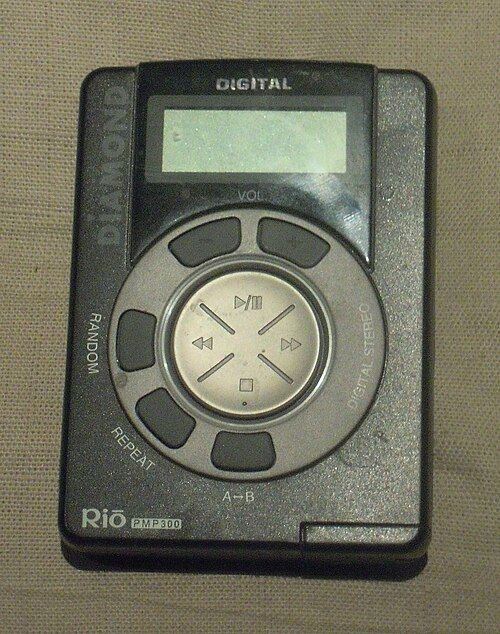

On 14 July 1995 an email poll at the **Fraunhofer Institute for Integrated Circuits** in Erlangen, one of the institutes of the **[Fraunhofer-Gesellschaft](kloom:e/fraunhofer-gesellschaft)**, settled what its engineers would call the files their coder made. They had been ending in _.bit_; from now on they would end in _.mp3_. The format behind the name was MPEG-1 Audio Layer III, the most complex of three ways of coding sound that the **[Moving Picture Experts Group](kloom:e/moving-picture-experts-group)** had approved in 1991 and published as a standard in 1993. **[MP3](kloom:e/mp3)** came chiefly from Erlangen, from a team led by **[Karlheinz Brandenburg](kloom:e/karlheinz-brandenburg)**, who had begun work on compressing music as a doctoral student at the University of Erlangen-Nuremberg in the early 1980s, for a professor, Dieter Seitzer, who wanted to send music down telephone lines.

The problem was size. A [compact disc](kloom:e/compact-disc) holds 44,100 samples a second, of 16 bits each, in two channels: 1,411.2 kilobits for every second of music. An MP3 at 128 kilobits a second is about eleven times smaller, and to most listeners sounds the same.

## What the ear will not miss

The trick is **[auditory masking](kloom:e/auditory-masking)**. A loud sound makes quieter sounds near it in pitch hard or impossible to hear: a strong tone at 1,000 hertz will cover a quieter one at 1,100. The cover spreads further upward in pitch than downward, and it works in time too, for about 20 milliseconds before a loud sound starts and for a hundred or so after it stops. The American physicist Alfred Mayer reported in 1894 that one tone could make another inaudible. The plate draws the effect: around a loud tone the threshold of hearing rises into a tent, and quieter tones that fall inside it, drawn dashed, are not heard at all. (Its curve is computed from standard approximations, and its quieter tones are an invented example.)

A perceptual coder, Brandenburg wrote in 1999, has four parts. A **filter bank** splits the sound into frequency bands: in MP3, 32 bands, each cut again into 18 by a **[modified discrete cosine transform](kloom:e/modified-discrete-cosine-transform)**, 576 lines in all. A **psychoacoustic model**, working from a 1,024-point **[fast Fourier transform](kloom:e/fast-fourier-transform)** of the same moment, estimates how much noise each band can hide. The coder then rounds each band's numbers as coarsely as that allows, keeping the noise of the rounding under the masking threshold, and packs the result with Huffman codes. Bits go only where the ear will hear them. In 1988 James Johnston at Bell Labs had reported a coder of this kind for single-channel sound that, in a formal listening test at 128 kilobits a second, could not be told from the original.

| Bit rate (kbit/s) | Smaller than a CD | One minute of stereo |
| ----------------: | ----------------: | -------------------: |
|      1,411.2 (CD) |               1 × |              10.6 MB |
|               320 |             4.4 × |               2.4 MB |
|               192 |             7.4 × |              1.44 MB |
|               128 |              11 × |              0.96 MB |
|                32 |              44 × |              0.24 MB |

The ratios and sizes are our arithmetic from the bit rates; 32 and 320 are the lowest and highest the standard allows for MPEG-1.

Pushed too far, the coder is heard. Brandenburg listed the faults: a castanet's sharp attack smeared into a hiss that starts _before_ the click, the _pre-echo_; high frequencies that come and go every 24 milliseconds; a single voice that sounds as if two takes were laid over each other, which engineers called _double-speak_.

## The voice in "Tom's Diner"

Brandenburg's hardest test was **[Suzanne Vega](kloom:e/suzanne-vega)**'s "**[Tom's Diner](kloom:e/toms-diner)**", which opens her album _Solitude Standing_ of 1987: two minutes of one voice, close to the microphone and alone, with nothing behind it to hide a flaw. He has told how he found it in two ways. In _Business 2.0_, as Vega quoted it in 2008, he heard it on a radio down a corridor: "I was electrified. I knew it would be nearly impossible to compress this warm a cappella voice." In a Swedish documentary of 2009 he said he had read that a hi-fi magazine used it to test loudspeakers, and that at bit rates "where everything else sounded quite nice, Suzanne Vega's voice sounded horrible."

Vega visited Erlangen in 2007 and heard the early versions, "monstrous and weird". To her ears the finished MP3 still had a little more high end and a little less warmth than her recording. "No, Miss Vega," an engineer told her, "it is exactly the same."

## Out of the lab, and into court

Fraunhofer released an encoder in 1994 and a player for Windows PCs in 1995. Nullsoft's **[Winamp](kloom:e/winamp)** of 1997 made playing MP3s easy, and in September 1998 Diamond Multimedia announced the **[Rio PMP300](kloom:e/rio-pmp300)**, a player the size of a cassette that held about an hour of music.

The **[Recording Industry Association of America](kloom:e/recording-industry-association-of-america)** sued to stop the Rio. It lost: in June 1999 the Ninth Circuit held that the Rio "merely makes copies in order to render portable, or 'space-shift,' those files that already reside on a user's hard drive," a "paradigmatic noncommercial personal use." That same month **[Shawn Fanning](kloom:e/shawn-fanning)**, with Sean Parker, launched **[Napster](kloom:e/napster)**, which let millions of people swap MP3s from one another's hard drives; it peaked at 26.4 million users in February 2001. In February 2001 the same court refused Napster the Rio's defense: once a song is listed there, it is "available to millions of other individuals." Napster shut down in July 2001.

Fraunhofer and Thomson licensed the patents, and the Fraunhofer-Gesellschaft took in hundreds of millions of euros from them. The licensing program ended on 23 April 2017, as the last American patents ran out. By then the business had already moved on, from owning files to streaming them.
