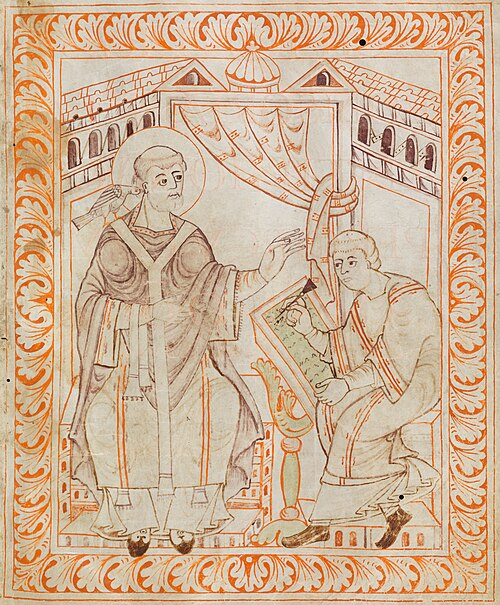

In 789 **[Charlemagne](kloom:e/charlemagne)** sent out a long list of orders to the churches of his kingdom, the **[Admonitio generalis](kloom:e/admonitio-generalis)**. Its eightieth chapter is three lines, addressed "to all the clergy": "That they learn the Roman chant thoroughly, and that the night office and the gradual be sung in due order, as our father of blessed memory, King Pepin, strove to bring about when he did away with the Gallican, for unity with the apostolic see and the peaceful concord of God's holy church" (in our translation). A song was to be the same in every church of the kingdom. Well over a century later the monks of Saint Gall were writing it down with signs above the words, and those signs are where Western music notation begins.

## Rome's song in Frankish mouths

**[Pepin the Short](kloom:e/pepin-the-short)** had turned to Rome in 754, when **[Pope Stephen II](kloom:e/pope-stephen-ii)**, fetched from Rome by Bishop Chrodegang of **[Metz](kloom:e/metz)**, spent most of the year in Francia seeking help against the Lombards, and anointed Pepin again at Saint-Denis. The pope's clerics, wrote the monk Walafrid Strabo, brought the Roman chant with them, and Chrodegang introduced it in his own cathedral.

But a song carried in memory changes as it travels. **[Notker the Stammerer](kloom:e/notker-the-stammerer)**, a monk of Saint Gall, told a story in the 880s that, in A. J. Grant's translation, he "could hardly believe" himself: Charlemagne asked the pope for twelve singers, and the Romans, jealous of the Franks, agreed among themselves to vary their singing, so that each "began to chant as differently as possible, and to teach others to sing in like fashion, and in as false a manner as they could invent." Charlemagne, hearing Christmas sung at Trier or Metz one year and at Paris or Tours the next, noticed. In Notker's day, he wrote, the church's chant north of the Alps was simply called "Metensian," the chant of Metz. The tale is a legend; its worry was real.

What the Franks made was not Rome's chant either. **[Old Roman chant](kloom:e/old-roman-chant)**, the song of Rome's own churches, written down only from 1071, shares its texts and many outlines with the Frankish books but is more ornate. Willi Apel and Robert Snow argued, in a view many share, that both descend from the Roman chant of about 750, which the Franks reshaped with their own **[Gallican chant](kloom:e/gallican-chant)** and fitted into a system of eight modes, the _oktoechos_, probably borrowed from Byzantine chant: four pairs, each with a high and a low form, by which every melody was sorted. That Frankish-Roman chant is what we call **[Gregorian chant](kloom:e/gregorian-chant)**.

## Gregory and the dove

The name honors **[Gregory the Great](kloom:e/pope-gregory-i)**, pope from 590 to 604. The earliest surviving claim that he compiled the chant book comes from John the Deacon's life of him, written about 873, almost three centuries after his death. A story credited to his friend Peter the Deacon has a secretary peer through a curtain and see a dove with its beak between the pope's lips while he dictated his homilies on Ezekiel. In the antiphoner made at Saint Gall by the monk Hartker about 1000, the scene opens a book of chant: the dove at Gregory's ear, a scribe writing at his word. Historians call it a legend because the story first concerned a sermon, not a song, because the melodies in the Frankish books did not exist in that form in Gregory's day, and because no notation existed to write them in.

## Signs above the words

The **[neumes](kloom:e/neume)** (from a Greek word for a sign, or perhaps for breath) were written above each syllable, and each showed how the voice moved on it:

| Neume     | Its name means | Notes | How the voice moves           |
| --------- | -------------- | ----- | ----------------------------- |
| Punctum   | point          | 1     | one note, written as a dot    |
| Virga     | rod            | 1     | one note, written as a stroke |
| Pes       | foot           | 2     | up, the lower note sung first |
| Clivis    | slope          | 2     | down                          |
| Torculus  | twisted        | 3     | up, then down                 |
| Porrectus | raised         | 3     | down, then up                 |

The first whole books of notated chant come from the tenth century. The cantatorium of the **[Abbey of Saint Gall](kloom:e/abbey-of-saint-gall)**, the book of the Mass chants a soloist sang, was written about 922–926; the Laon gradual about 930; scattered neumes survive from the century before.

On its page for the first Sunday of Advent the introit _Ad te levavi_, a chant for the choir, stands as words alone; the gradual _Universi qui te expectant_, which a soloist sang, carries neumes above each syllable, and on "domine" they crowd into a long run of notes on one vowel. Members of Schola Antiqua recorded the gradual in 2004: nearly three minutes.

## What the signs left out

A neume says up, down, quickly, or with a waver; it does not say how far. **[Hucbald](kloom:e/hucbald)**, a monk of Saint-Amand, complained about 880 that the neumes "always lead the reader by an uncertain track" (in our translation): over an _Alleluia_, a singer could not tell whether the second note lay one, two or three steps from the first, "unless you hear it from another." The plate draws one set of neumes over two invented tunes that both fit it. A teacher still sang each melody first, and it was learned by ear. Hucbald proposed setting letters, which name pitches, above or beside the neumes, and keeping the neumes for what letters could not show: speed, a tremble, how notes join.

How much the first books fixed is argued. **[Kenneth Levy](kloom:e/kenneth-levy)** argued in 1987 that the whole Frankish repertory of Mass chants was neumed under Charlemagne, a century before the surviving books. **[Leo Treitler](kloom:e/leo-treitler)**, comparing chant with Homer's oral epics, had studied it as an art carried in memory. Either way, the next step was to fix pitch on the page itself, and a monk at Arezzo took it.
