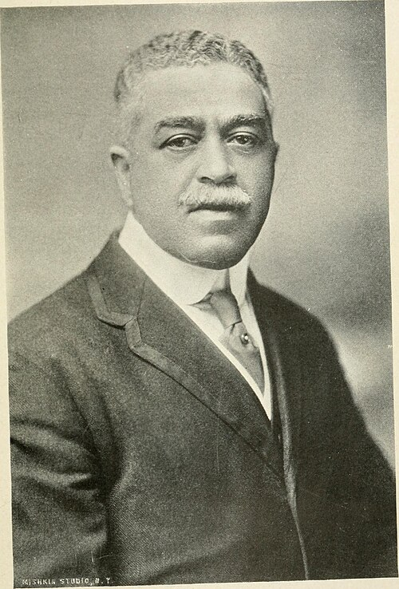

In September 1892 the Czech composer **[Antonín Dvořák](kloom:e/antonin-dvorak)** landed at Hoboken with his wife and two of their children to run a music school in **[New York City](kloom:e/new-york-city)**. Its founder, **[Jeannette Thurber](kloom:e/jeannette-thurber)**, a wealthy patron, had offered him $15,000 a year, about twenty-five times his salary at the Prague Conservatory. She wanted a national school of American composers, and she had hired the man who had made Czech folk rhythms into symphonies. The **[National Conservatory of Music of America](kloom:e/national-conservatory-of-music-of-america)**, founded in 1885, took women and Black students, and in 1893 its trustees offered Black students free tuition, with two of them hired to teach the beginners.

## "The product of the soil"

One of those two was **[Harry Burleigh](kloom:e/harry-burleigh)**, a baritone from Erie, Pennsylvania, who had won a scholarship in January 1892 at 25. He had learned the old plantation songs from his grandfather, Hamilton Waters, who had bought his own freedom from slavery in Maryland in 1832. In New York Burleigh copied orchestral parts for Dvořák, played double bass in the school's orchestra, and sang for him in the evenings. In May 1893 the _New York Herald_ printed an interview, reprinted across the country. In the words of the Black weekly **[_The Cleveland Gazette_](kloom:e/the-cleveland-gazette)**, which ran it on its front page on 3 June, Dvořák said: "I am now satisfied that the future music of this country must be founded upon what are called the Negro melodies. This must be the real foundation of any serious and original school of composition to be developed in the United States." These **[spirituals](kloom:e/spirituals)** and plantation songs, he went on, "are the product of the soil. They are American." The _Gazette_ agreed in an editorial, saying that the songs "furnished by our people while in the toils of slavery" must be the foundation of any such school.

## Five notes, four bars

The **[Symphony No. 9](kloom:e/symphony-no-9-dvorak)**, "From the New World," was written in New York between January and May 1893. The slow movement opens with seven chords in the brass and woodwinds, swelling and dying away; the muted strings enter very softly in D-flat, and a **[cor anglais](kloom:e/cor-anglais)** plays a tune alone, very slowly, 52 quarter notes to the minute. By our reading of the 1903 printed score, its first four bars use only four notes: D-flat, E-flat, F and A-flat. They are four of the five notes of a **[pentatonic scale](kloom:e/pentatonic-scale)**, the kind the piano's black keys play and folk songs around the world use, and in those bars the tune never touches the fourth of the key (G-flat) or its seventh (C). On the day of the first public hearing the _New-York Tribune_, whose critic **[Henry Krehbiel](kloom:e/henry-edward-krehbiel)** had championed Dvořák's idea, explained that the theme was built on the five-note scale, "common to the slave songs of the South," and on the "Scotch snap," a short note on the beat before a long one.

Does the symphony quote a spiritual? Burleigh told it more than one way over the years. Once he said Dvořák "wrote some of my tunes (my people's music) into the New World Symphony"; once that he used "Swing Low, Sweet Chariot" for a flute theme "note for note"; and once that he "saturated himself with the spirit of these old tunes and then invented his own themes." Dvořák himself told the _Herald_ that he had written original themes in the spirit of Native American music and had been thinking of **[Longfellow](kloom:e/henry-wadsworth-longfellow)**'s _Song of Hiawatha_. Claims that Dvořák borrowed actual melodies are often made and seldom supported by specifics; the scale and the rhythms are what can be shown. The best-known "spiritual" in it was made later. In 1922 a former student, William Arms Fisher, put words to the Largo's melody as "Goin' Home," and it has often been taken for a traditional spiritual since.

## The first night

The **[New York Philharmonic Society](kloom:e/new-york-philharmonic)** played the symphony under Anton Seidl at **[Carnegie Hall](kloom:e/carnegie-hall)**, then called the Music Hall, at a public rehearsal on 15 December 1893 and in concert the next night. The audience applauded every movement; the _Tribune_ reported that Dvořák had to bow from his box after the slow movement and again after the finale. Not every musician agreed. Some critics, the _Tribune_ said, mocked Dvořák with a racial slur, and the composer Edward MacDowell wrote later that "what Negro melodies have to do with Americanism in art still remains a mystery." The Library of Congress holds a Victor disc of the Largo recorded in December 1912, in an arrangement by Charles J. Roberts, with Alfred Doucet listed on the oboe.

| Nation  | Composer                                                       | What made it national                                   |
| ------- | -------------------------------------------------------------- | ------------------------------------------------------- |
| Bohemia | Bedřich Smetana (1824–1884)                                    | _Má vlast_, symphonic poems on the land and its legends |
| Bohemia | Antonín Dvořák (1841–1904)                                     | Rhythms of Bohemian and Moravian folk music             |
| Norway  | Edvard Grieg (1843–1907)                                       | A Norwegian idiom of his own                            |
| Russia  | The Five: Balakirev, Cui, Mussorgsky, Rimsky-Korsakov, Borodin | A Russian classical music, together                     |

Dvořák's advice belonged to a European movement. **[Bedřich Smetana](kloom:e/bedrich-smetana)** had made music the voice of Bohemia's hopes for its own state, and in Russia The Five set out together to write a Russian classical music. What was new was where Dvořák told Americans to look: to the songs of the people who had been enslaved. Those songs had already crossed the Atlantic, carried by a student choir from Nashville that began the next part of this story, the Fisk Jubilee Singers.
