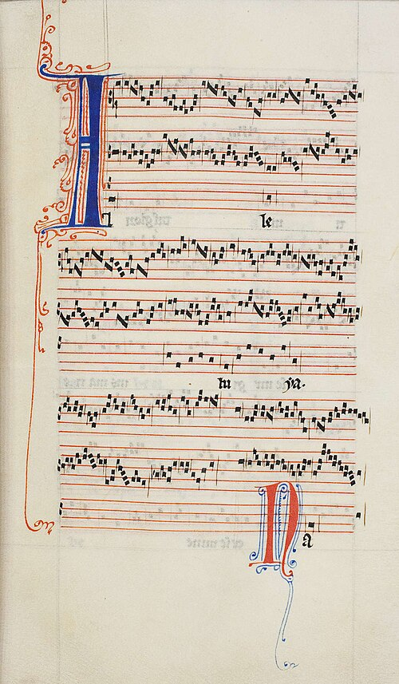

In 1163 **[Maurice de Sully](kloom:e/maurice-de-sully)**, bishop of Paris, began a new cathedral on the Île de la Cité, in the Gothic style first tried at **[Saint-Denis](kloom:e/basilica-of-saint-denis)** twenty years before. The high altar of **[Notre-Dame de Paris](kloom:e/notre-dame-de-paris)** was consecrated in 1182, and in its choir, through the decades the nave was rising, the singers of the cathedral made something new: polyphony written down, measured in time, and copied across Europe. Two of them are known by name, **[Léonin](kloom:e/leonin)** and **[Pérotin](kloom:e/perotin)**. Hardly anything else about them is.

## The chant held still

Singing a second voice against the chant was old. A treatise of about 895, the _Musica enchiriadis_, taught singers to double a melody a fourth or fifth below. What Paris did with **[organum](kloom:e/organum)** was to slow the chant down until each of its notes became a floor. The lower voice, the _tenor_ (from the Latin for "to hold"), sustains one note of the old melody for many breaths; above it a soloist, the _duplum_, unwinds a long, rising and falling line, coming back to rest on an octave, fifth or fourth above the held note before the tenor moves on. Where the chant itself was florid, both voices moved in measure, in a style the Parisians called discant, and these sections, the _clausulae_, could be cut out and replaced: one Florentine manuscript holds 462 of them.

The page shows it plainly. In Pérotin's _Alleluia Nativitas_, copied in the thirteenth century, the two upper staves of each system are full from edge to edge; the third holds a handful of notes, each to be sung as long as the voices above need. Pérotin wrote for three voices, and twice for four. His four-voice **[_Viderunt omnes_](kloom:e/viderunt-omnes)**, the gradual for Christmas, stretches the chant's opening syllables so far beneath three busy upper voices that the words can hardly be followed.

## Long and short

To keep three or four soloists together, the Paris singers measured time. Their notes still had no shapes for "long" and "short." Instead, the grouping of notes into joined figures, ligatures, told the singer which of six patterns, the **[rhythmic modes](kloom:e/rhythmic-mode)**, a passage followed. Every pattern counts in threes.

| Mode | Pattern           | Classical foot | Ligatures |
| ---- | ----------------- | -------------- | --------- |
| 1    | long–short        | trochee        | 3, 2, 2…  |
| 2    | short–long        | iamb           | 2, 2…, 3  |
| 3    | long–short–short  | dactyl         | 1, 3, 3…  |
| 4    | short–short–long  | anapaest       | 3, 3…, 1  |
| 5    | long–long         | spondee        | 3, 3, 3…  |
| 6    | short–short–short | tribrach       | 4, 3, 3…  |

The first mode was by far the most used. The plate draws it: a tenor holding one note and the voice above it moving long, short, long, short. Some medieval writers explained the triple measure as honoring the Trinity, an explanation that seems to have come after the fact.

## A student's note

Almost all we know of the two composers comes from an English writer of about 1280, called **[Anonymous IV](kloom:e/anonymous-iv)** since a nineteenth-century edition numbered him so, probably a student in Paris and a man, John Haines argues, steeped in the geometry taught at the **[University of Paris](kloom:e/university-of-paris)**. He writes, in our translation from the Latin:

> And note that Master Leoninus, as was said, was the best maker of organum, who made the great book of organum on the gradual and antiphonary to enrich the divine service. It was in use until the time of Perotinus the Great, who shortened it and made very many better clausulae, since he was the best maker of discant.

That "great book" is the **[_Magnus liber_](kloom:e/magnus-liber)**. No copy of it survives from their time; the three main manuscripts were made from about the 1230s, two generations later. Both men are called _magister_, a master licensed to teach in the Paris schools. Craig Wright has proposed that Léonin was the Paris poet Leonius; others have tried to match Pérotin with one of the many Peters of the cathedral, and none of the identifications is accepted. Scholars disagree on the music too. William Waite in 1954 credited Léonin himself with bringing "a rational system of rhythm" into polyphony; others give the modal notation to Pérotin's generation, and whether Léonin's free organum was sung in strict modes or more freely is still argued.

## A bishop's order

One date anchors Pérotin. In 1198 the papal legate, Peter of Capua, complained that the Feast of the Circumcision, on 1 January, had become so wild at Notre-Dame that the church was stained "with foul words and often with the shedding of blood," a day "commonly called, not undeservedly, the feast of fools" (in our translation). Bishop **[Eudes de Sully](kloom:e/eudes-de-sully)** answered with a decree setting out the feast's services, and ordering that at Mass the responsory and Alleluia be sung "in triplo, vel quadruplo, vel organo," in three parts, four, or organum, by singers in silk copes. The responsory of that Mass is _Viderunt omnes_, which is why Pérotin's setting is often dated to that day; some histories say Christmas 1198 instead. In 1208 his successor confirmed what Eudes had endowed: six Paris pence a year to each cleric who sang the responsory or Alleluia in organum of three or four voices at the Mass of St Stephen's Day.

In the thirteenth century, singers began to give the upper voices of the _clausulae_ new words of their own, and the **[motet](kloom:e/motet)** (from the French _mot_, word) was born. Its rhythms, written in ever smaller notes, would soon outgrow the modes, and a pope would object.
