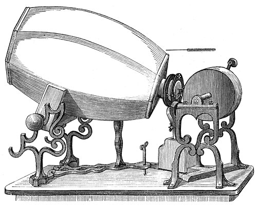

In the 1850s **[Édouard-Léon Scott de Martinville](kloom:e/edouard-leon-scott-de-martinville)** set type and read proofs for a scientific printer in **[Paris](kloom:e/paris)**. He had written a history of shorthand, and he wanted a machine that would take down speech by itself. On 26 January 1857 he gave the **[French Academy of Sciences](kloom:e/french-academy-of-sciences)** a sealed packet describing how, and on 25 March he was granted a French patent for the instrument he called the **[phonautograph](kloom:e/phonautograph)**. "Can we hope that the day is near," he asked in the packet, "when the musical phrase, fallen from the singer's lips, will write itself down on obedient paper, and leave a lasting trace of those fleeting melodies that memory can no longer find when it looks for them?" (our translation).

## An ear that writes

Scott copied the ear, whose engraved anatomy he had seen while setting a physiology textbook. A horn gathered the sound. At its narrow end, the width of a five-franc piece, he stretched a membrane for the eardrum and a second behind it for the oval window. To the center of the outer membrane he fixed, with a speck of modeling wax, a boar's bristle a centimeter or more long, "fine but suitably stiff." Its point just grazed a sheet coated with lampblack, the soot of an oil flame.

In 1857 the sheet was a strip of glass slid past the bristle at a meter a second. From July 1859 it was paper on a drum, turned by a crank and carried along on a screw through a nut, so that the trace ran round it in a spiral. The instrument maker Rudolph Koenig built these models, and from 1859 a tuning fork wrote a line beside the voice: a time scale against which its waves could be counted.

| Part                   | In the ear  | What it did                                   |
| ---------------------- | ----------- | --------------------------------------------- |
| Horn, lined in plaster | Outer ear   | Gathered the sound                            |
| Outer membrane         | Eardrum     | Moved with the air                            |
| Inner membrane         | Oval window | Set how sensitive the outer one was           |
| Boar's bristle         | (none)      | Scratched the membrane's motion into the soot |
| Lampblacked paper      | (none)      | Kept the trace, white on black                |
| Tuning fork (1859 on)  | (none)      | Wrote a reference line of known frequency     |

"One speaks near the horn," Scott wrote; "the membranes vibrate, the stylus swings like a pendulum and traces figures, large if the sound is loud, small if it is weak, far apart if it is low, close together if it is high, shaky and uneven if the tone is veiled, even and clean if it is pure" (our translation). The idea was older. In 1807 **[Thomas Young](kloom:e/thomas-young-scientist)** had described a turning barrel on which a point, joined to a sounding body, "will describe an undulated path on the roller." Scott claimed the next step: "I write not only the vibrations of the body that first vibrates, but those carried by a fluid, that is, by the surrounding air" (our translation).

He never meant the traces to be heard; they were to be read, like shorthand. Nobody learned to read speech from them, and Scott, who made no money from it, sold books and prints in Paris until his death in 1879.

## Played back in 2008

In December 2007 the audio historian David Giovannoni found Scott's phonautograms in the French patent office, and in March 2008, on a lead the historian Patrick Feaster had found in Scott's writings, more at the Academy. Their group called itself First Sounds. The best, dated 9 April 1860, was a sheet of rag paper nine inches by twenty-five. Its scans went to **[Carl Haber](kloom:e/carl-haber)** and Earl Cornell at **[Lawrence Berkeley National Laboratory](kloom:e/lawrence-berkeley-national-laboratory)**, who had built a "virtual stylus" with the **[Library of Congress](kloom:e/library-of-congress)** to play fragile records from images, following the line as if it were a groove; First Sounds stitched its sixteen passes together.

What came out was the French children's song **"[Au clair de la lune](kloom:e/au-clair-de-la-lune)"**: as The New York Times heard it in March 2008, ten seconds of "a hissing, crackling background din" through which an 11-note melody drifts.

| Release    | Fork taken as | What was heard                                                       |
| ---------- | ------------- | -------------------------------------------------------------------- |
| March 2008 | 500 waves/s   | A woman or girl, about ten seconds, "Pierrot répondit"               |
| May 2009   | 250 waves/s   | A man, about twenty seconds, singing very slowly                     |
| May 2010   | 250 waves/s   | "Au clair de la lune, mon ami Pierrot, prête moi—", with a near-stop |

Scott had labeled his fork "500 simple vibrations a second." In 2009 a phonautogram of lines from Tasso's _Aminta_, on which Scott apologized for getting the words in the wrong order, showed that the speaker was Scott himself, and at that speed he sounded like a tape at double speed. In the usage of his day, Feaster concluded, "500 simple vibrations" meant 250 waves a second. Played at that speed, "Au clair de la lune" is a low male voice, slow and heavy, carrying the tune through the hiss; between "Pierrot" and "prête" the drum all but stops, as if Scott paused to see how much paper was left.

## The oldest voice, and Edison

First Sounds calls it "the earliest clearly recognizable record of the human voice yet recovered." His earlier sheets, from 1853 or 1854 on, have no fork to fix their speed and cannot be made out. Until 2008 the oldest playable recordings were thought to be wax cylinders of Handel sung at the Crystal Palace in 1888.

When **[Thomas Edison](kloom:e/thomas-edison)**'s phonograph reached Paris in 1878, Scott printed his papers in a book, _Le problème de la parole s'écrivant elle-même_ ("the problem of speech writing itself"), to prove that France had come first. "What are the rights of the discoverer versus the improver?" he asked, in The New York Times's translation. Edison, he noted, "speaks with his nose almost glued to his membrane," and from half a meter away would record nothing (our translation). The scholar Terrence Cullen traces Scott's complaint, that the phonograph made noises rather than legible writing, to his shorthand. No evidence shows Edison knew of Scott's work, and the editor of Edison's papers, Paul Israel, put the difference plainly: Edison was trying to reproduce sound, "and he succeeded." That machine is the next frame, Edison's phonograph.
