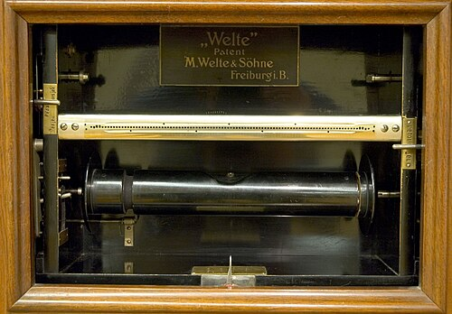

By the spring or summer of 1895, in a workshop at his home in Detroit, the organ builder **[Edwin S. Votey](kloom:e/edwin-s-votey)** had made a cabinet that stood in front of an ordinary **[piano](kloom:e/piano)** with a row of felt-tipped fingers resting on its keys. Its player pumped two pedals; a roll of paper turned; the fingers played. The **[Aeolian Company](kloom:e/aeolian-company)** of New York sold it from 1898 as the Pianola, at first for $250, and advertised it in full-page color. Even its patent is told two ways: Alfred Dolge's history of 1911 has Votey applying on January 25, 1897, and receiving it on May 22, 1900, while the Pianola Institute dates the application to November 1899 and the grant to July 1904, for an intermediate form never built. Soon the mechanism went inside the case, and the **[player piano](kloom:e/player-piano)** became a piano anyone could play, whether or not they had learned.

## Air through a hole

Everything in a player piano works by suction. The pedals drive bellows that pump air out of a chest, so the air inside it is at less than room pressure. The **[piano roll](kloom:e/piano-roll)** is a sheet of paper about eleven and a quarter inches wide, punched with a hole wherever a note sounds, its length standing for time. It runs over a brass tracker bar drilled with a row of small holes, one for each key: after the makers met at Buffalo in 1908, 88 of them, nine to the inch, so that any roll would play on any player.

While the paper covers a hole, nothing happens. When a perforation passes over it, air at room pressure rushes into the hole and down a tube, and the plate follows it. In the words of William Braid White's manual of 1914, the air "forces up the pouch," a disc of thin leather, which lifts a valve; the valve connects a small bellows, the striking pneumatic, to the chest, and "its contained air, being at higher pressure, rushes out." The pneumatic collapses and pushes up on the key's action, and the hammer strikes the string. When the paper closes the hole again, a tiny vent lets the pressure under the pouch fall, the valve drops back, and the pneumatic opens, ready to strike again. Most players add a small primary valve before this one, since so small a hole admits little air.

| Part                  | What it does                                                    |
| --------------------- | --------------------------------------------------------------- |
| Pedals and exhausters | pump air out, keeping the chest below room pressure             |
| Roll                  | carries the music as holes; its length is time                  |
| Tracker bar           | 88 holes, nine to the inch, one tube to each note               |
| Pouch and valve       | air entering the tube lifts the pouch, which opens the valve    |
| Striking pneumatic    | a small bellows that collapses and lifts the piano's action     |
| Air motor             | turns the take-up spool at a speed the player sets with a lever |

## Recording a pianist

An ordinary roll was marked out from the printed music, and the pedaler supplied the expression with levers. In 1904 Edwin Welte and Karl Bockisch of M. Welte & Söhne in Freiburg showed something more: the **[Welte-Mignon](kloom:e/welte-mignon)**, a reproducing piano, whose rolls were recorded from a pianist's own playing, with the tempo, the pedaling and the dynamics coded in holes along the edges and played back by an electric motor with no one at the instrument. **[Gustav Mahler](kloom:e/gustav-mahler)**, **[Edvard Grieg](kloom:e/edvard-grieg)**, **[Claude Debussy](kloom:e/claude-debussy)**, Saint-Saëns and Scriabin recorded their own music for it. Carl Reinecke, born in 1824, recorded in January 1905, at eighty; he is the earliest-born pianist whose playing survives in any form.

How faithful are they? Welte guarded its recording machine, and it was lost, so how precisely it captured a performance can only be inferred. The Pianola Institute hears "astounding realism" in some rolls and "a certain lack of detail when the musical texture becomes too complex," and notes that wrong notes were usually left in, as in a photograph. The dynamics are coded for the bass and treble halves of the keyboard, divided between F♯ and G above middle C, which limits, Schmitz notes, how differently two notes struck together can sound. Critics blamed the tempos too; the Welte scholar Hans-W. Schmitz answers that a mechanism set up as Welte specified holds its speed to within 2 percent over a long roll. When a Mahler roll sounds odd, it may be Mahler or the machine.

## Boom and silence

By the census of 1919, American factories made more player uprights than ordinary ones, 177,500 to 138,000, and the player cost more: $297 each at the factory against $213. They peaked at 184,000 in 1923. Then the radio, and records made with microphones, gave the parlor music with no pedaling at all, and by the census figures the fall began well before the stock market crashed in 1929. In 1931, at the bottom of the **[Great Depression](kloom:e/great-depression)**, the factories made 1,800.

One composer took up the abandoned machine. **[Conlon Nancarrow](kloom:e/conlon-nancarrow)**, an American who had fought in the Spanish Civil War and settled in Mexico in 1940, read in **[Henry Cowell](kloom:e/henry-cowell)**'s _New Musical Resources_ that rhythm might have a scale as pitch has. From 1947 he punched rolls by hand on a machine of his own, slowly, for two player pianos he rebuilt, and wrote studies in tempos no hands could keep: canons whose voices run at ratios such as 3 to 4, and one, Study No. 40, at _e_ to π. [Columbia](kloom:e/columbia-records) released a record of them in 1969, and he became widely known only in the 1980s.

A roll is a program in one sense: instructions stored as holes and read by a machine in order, as the **[Jacquard loom](kloom:e/jacquard-machine)**'s cards were. It makes no decisions; it plays what was punched. Its descendant is the "piano roll" view of MIDI software, a grid of notes against time, and it hands on, in this trail, to a piano that needed no strings: the Rhodes.
