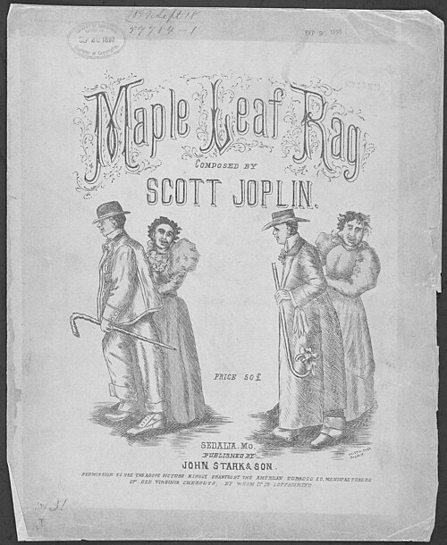

On 10 August 1899, in the railroad town of **[Sedalia](kloom:e/sedalia-missouri)**, Missouri, the composer **[Scott Joplin](kloom:e/scott-joplin)** signed a one-page agreement with the music dealer **[John Stark](kloom:e/john-stillwell-stark)** and his son to publish the **[Maple Leaf Rag](kloom:e/maple-leaf-rag)**. Joplin, it says, "has composed a certain piece of music entitled Maple Leaf Rag and has not funds sufficient to publish same." Stark & Son would pay for the plates, the copyright and the printing; Joplin would have his name on every copy, ten copies free, and "a royalty of one cent per copy on each copy of said piece of music sold"; he could buy more at five cents to sell himself, and, in a sentence added in the hand of the attorney who witnessed it, H. A. Higdon, neither of them would sell it for less than 25 cents. The cover asked 50, and its drawing of two couples stepping out was borrowed, a line at its foot says, from the American Tobacco Company, makers of Old Virginia Cheroots. The rag was registered for copyright in September.

## A march that leans

Joplin was born in Texas in about 1868, the son of Giles Joplin, who had been enslaved in North Carolina, and Florence Givens, born free in Kentucky; his first biographers gave Texarkana, and the census of 1870 puts him at Linden. A German-born teacher, Julius Weiss, taught him for nothing. He played through the South, in Chicago at the World's Fair of 1893, and from 1894 in Sedalia, at clubs such as the Maple Leaf, which may have given the rag its name; no document says so.

**[Ragtime](kloom:e/ragtime)** was then a few years old in print. Its pianist plays a march, marked _Tempo di marcia_ on Joplin's first page, but makes it lean. The left hand keeps strict time in eighth notes, low octaves and chords, the "oom-pah." The right hand plays in sixteenths and lands between them. The plate draws the first bar as a roll would punch it, each note as long as it sounds: in A-flat major, 2/4, the right hand rests on the downbeat, strikes on the sixteenths between the left hand's eighths, and holds an octave E-flat across the "and" of the second beat. That is **[syncopation](kloom:e/syncopation)**, accents placed where the beat is not.

| Count      | 1         | e   | &         | a   | 2       | e         | &        | a   |
| ---------- | --------- | --- | --------- | --- | ------- | --------- | -------- | --- |
| Left hand  | A♭ octave |     | E♭–A♭–C   |     | E♭–A♭–C |           | A octave |     |
| Right hand | rest      | A♭  | E♭ octave | A♭  | C       | E♭ octave | (held)   | G   |

Joplin wrote down how to play it. His _School of Ragtime_ (1908) begins: "Syncopations are no indication of light or trashy music." Its fifth exercise describes this very figure, where "instead of a tie, it is an eighth note," and its first insists: "never play ragtime fast at any time."

## How many copies?

Ragtime sold as sheet music, to a country of parlor **[pianos](kloom:e/piano)**, through a trade that by 1900 was centered on West 28th Street in Manhattan, soon called **[Tin Pan Alley](kloom:e/tin-pan-alley)**. The same trade sold "coon songs," whose racist caricatures of Black people were marketed under the ragtime name. How well the Maple Leaf sold is disputed. Rudi Blesh, Joplin's first biographer, wrote that it sold 75,000 copies in its first six months, and later claims run to a million. Edward A. Berlin found that the first printing of 400 copies took a year to sell, earning Joplin $4 at a cent a copy, and estimated that by 1909 the rag brought him about $600 a year. It was a steady income, never a fortune. In 1901 Joplin moved to **[St. Louis](kloom:e/st-louis)**.

## Treemonisha and the rolls

In 1907 Joplin moved to New York to find a producer for an opera. Unable to find a publisher, he printed **[_Treemonisha_](kloom:e/treemonisha)** himself in 1911, the story of a young woman who leads a community of freed people by learning to read. It was never fully staged in his lifetime. He gave it in a rehearsal hall in Harlem in 1915, with only himself at the piano, to listeners who walked out; Rick Benjamin has since found that Joplin also gave it for paying audiences in Bayonne, New Jersey, in 1913.

By 1916 Joplin had neurosyphilis. That year he cut seven rolls for the **[player piano](kloom:e/player-piano)**; on the **[piano roll](kloom:e/piano-roll)** of the Maple Leaf Rag that Aeolian issued in June, Blesh heard playing "shocking ... disorganized," and Berlin, "painfully bad," the truest record of how Joplin played by then. He was admitted to Manhattan State Hospital in February 1917 and died there on 1 April, and was buried in a grave left unmarked until 1974.

The revival began with a record. **[Joshua Rifkin](kloom:e/joshua-rifkin)**'s _Scott Joplin: Piano Rags_ (Nonesuch, November 1970) sold 100,000 copies in its first year. The film **[_The Sting_](kloom:e/the-sting)** (1973) used Marvin Hamlisch's adaptations, and his "The Entertainer" reached number 3 on the _Billboard_ Hot 100 in 1974. _Treemonisha_ was staged in Atlanta in January 1972 and by the Houston Grand Opera in 1975, and in 1976 Joplin was given a special **[Pulitzer Prize](kloom:e/pulitzer-prize)**, "bestowed posthumously in this Bicentennial Year, for his contributions to American music." A rag was written to be read and played. The blues, a few years on, would be sold on records.
