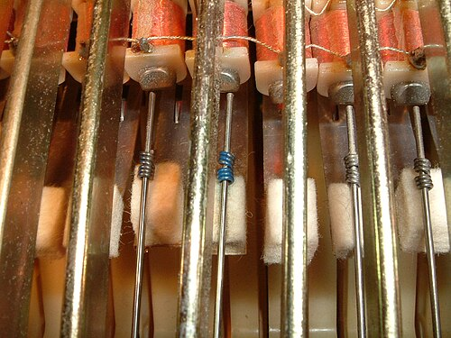

**[Harold Rhodes](kloom:e/harold-rhodes)** began teaching piano at nineteen, left the University of Southern California in 1929 to support his family, and built a method of teaching that joined classical reading to jazz improvisation. In the Second World War he joined the Army Air Corps and taught piano to airmen recovering in hospital, and he wanted an instrument they could play in bed. How he built it is told two ways. The _New York Times_ obituary of 2001 says that in 1942 he made a 29-note keyboard "using aluminum tubing from a B-17," the "Army Air Corps lap model piano." Newspapers of 1945, as quoted in Wikipedia's article on the instrument, call it the Xylette and say the patients built it themselves in the hospitals' craft shops: bars "made from discarded hydraulic systems, the plywood from hatchways, keys from the fuselage spruce, and hammers from the hardwood of the propellor."

After the war Rhodes made an amplified 38-note Pre-Piano in Pasadena, sold from 1948 for $189.50 and advertised as never needing tuning. In the late 1950s he went into business with **[Leo Fender](kloom:e/leo-fender)**, the maker of electric guitars and amplifiers in Fullerton (the obituary says Fender bought his company in 1959), and Fender made a 32-note Piano Bass. In January 1965 Fender sold his companies to CBS for $13 million, and under CBS the 73-note **[Rhodes piano](kloom:e/rhodes-piano)** appeared, sold as the Fender Rhodes.

## A tuning fork with a pickup

Rhodes described it in his patent of 1961. Each key throws a hammer up against a **tine**, a short rod of piano wire, near its root. The tine's end is pressed into a hole in the thick end of a heavier **tone bar** of cast iron: the two are the prongs of an unequal tuning fork, and the bar's job is to steady the tine and let it ring. Struck alone, Rhodes wrote, such a bar makes "little or no audible sound." A small coiled spring grips the tine as a weight; sliding it along tunes the note. Beside the tine's free tip sits an electromagnetic **pickup**, a coil of fine wire around a magnet. As the steel tine swings, it changes the magnetic field through the coil and drives a voltage in it, by **[Faraday's law of induction](kloom:e/faradays-law-of-induction)**, the same principle as the electric guitar's pickup. The amplifier and speaker do the rest. Unplugged, a Rhodes still sounds, but faintly.

| Part          | Made of                            | What it does                                   |
| ------------- | ---------------------------------- | ---------------------------------------------- |
| Key, hammer   | wood, felt tip (neoprene, 1971)    | strikes the tine near its root                 |
| Tine          | piano wire                         | vibrates; its length and spring set the pitch  |
| Tuning spring | steel coil                         | a sliding weight on the tine                   |
| Tone bar      | cast iron, or aluminum in the bass | the other prong of the fork; sustains the tine |
| Pickup        | magnet in a coil                   | turns the tine's motion into a voltage         |
| Damper        | felt                               | stops the tine when the key is let go          |

The patent says what Rhodes wanted to hear: "an initial percussive effect followed by a relatively rapid decay and then by a limited dwell," with "a strong preponderance of the fundamental." That is the Rhodes: a struck onset, then a round tone, nearly pure, fading slowly, longer in the bass than the treble. The nearer the tine sits to the pickup, the more it rings like a bell. The obituary heard a "pure, tinkling tone" that "could shimmer between speakers in a stereo-vibrato effect, or bite like a wah-wah guitar."

## On record

**[Herbie Hancock](kloom:e/herbie-hancock)** first met the instrument in 1968, at a session for **[Miles Davis](kloom:e/miles-davis)**, and found that the amplification let him be heard in a loud band. On February 18, 1969, at CBS's 30th Street studio in New York, Davis recorded **[_In a Silent Way_](kloom:e/in-a-silent-way)** with three electric keyboard players, Hancock, Chick Corea and Joe Zawinul. Davis stripped Zawinul's title tune of its chord changes and left its melody over a single held bass note, and the producer Teo Macero cut the takes into two long sides. [Columbia](kloom:e/columbia-records), the record label CBS also owned, released it that July. The critic Phil Freeman heard "Miles Davis and Teo Macero feeling their way down an unlit hall at three in the morning."

Rhodes had rivals that sounded different because they struck different things:

| Instrument                 | From | Struck                  | Heard on                              |
| -------------------------- | ---- | ----------------------- | ------------------------------------- |
| Wurlitzer electronic piano | 1954 | flat steel reeds        | Ray Charles, "What'd I Say" (1959)    |
| Rhodes                     | 1965 | tines with tone bars    | Miles Davis, _In a Silent Way_ (1969) |
| Hohner Clavinet            | 1964 | strings, by rubber pads | Stevie Wonder, "Superstition" (1972)  |

The **[Wurlitzer electronic piano](kloom:e/wurlitzer-electronic-piano)** has a reedy bite when played hard; the **[Clavinet](kloom:e/clavinet)**, a clavichord with pickups, can sound like an electric guitar, and **[Stevie Wonder](kloom:e/stevie-wonder)** often played it and the Rhodes on the same records. In 1976 the company advertised that 82 percent of the top hundred albums on Billboard with an electric piano used a Rhodes.

Digital instruments imitated it. Yamaha's DX7 of 1983 had a Rhodes sound that several players took instead, and after Roland bought the name in 1987 it sold digital "Rhodes" pianos that Harold Rhodes disliked: "He wouldn't have one in the house," his widow said. He regained the name in 1997 and died in December 2000. The instrument still works the way its patent said, a hammer on a fork of wire and iron, a long way from the wooden piano Mozart played in Vienna.
