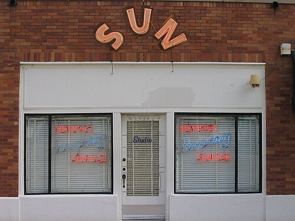

On the evening of 5 July 1954, in a storefront studio at 706 Union Avenue in **[Memphis](kloom:e/memphis-tennessee)**, three young white musicians were trying ballads for **[Sam Phillips](kloom:e/sam-phillips-record-producer)**. Between takes the singer, nineteen-year-old **[Elvis Presley](kloom:e/elvis-presley)**, began fooling with a blues he knew, **["That's All Right,"](kloom:e/thats-all-right)** which **[Arthur Crudup](kloom:e/arthur-crudup)** had written and recorded in Chicago in 1946. Bill Black joined in on the string bass, Scotty Moore on lead guitar, and Phillips asked them to start again so he could record it. There are no drums. Presley strums an acoustic guitar hard and sings high and loose; Black slaps the bass strings against the fingerboard so that each note clicks like a snare; Moore answers the voice with short, bright phrases. It runs at least twice as fast as Crudup's record.

On 7 July the disc jockey Dewey Phillips (no relation) played the acetate on his program on WHBQ, by one account fourteen times. He brought Presley in for an interview and asked him which high school he went to, a way of telling listeners, in a segregated city, that the singer was white. **[Sun Records](kloom:e/sun-records)** released it on 19 July as Sun 209. It sold about 20,000 copies and reached number four in Memphis.

## Which record was first?

Phillips had opened the Memphis Recording Service in 1950, recording anyone who paid, and many of his first artists were Black: B. B. King, Howlin' Wolf, Junior Parker. In March 1951 he recorded **["Rocket 88"](kloom:e/rocket-88)** by a band from Clarksdale, Mississippi, led by the nineteen-year-old pianist **[Ike Turner](kloom:e/ike-turner)**, with Jackie Brenston singing a boast about an Oldsmobile. Willie Kizart's guitar amplifier had been damaged on the drive north, and Phillips stuffed paper into the broken speaker cone; the guitar came out fuzzed and distorted, under Turner's pounding boogie piano and a saxophone. Phillips leased it to Chess Records in Chicago, which credited it to "Jackie Brenston and his Delta Cats." It went to number one on the rhythm and blues chart. Turner's musicians were paid $20 each; Brenston sold his rights for $910.

Phillips called "Rocket 88" the first rock and roll record, and so do many writers. Others name earlier records, or none. Turner himself said, "I don't think that 'Rocket 88' is rock 'n' roll," but called it "the cause of rock and roll existing," and the _Guardian_ suggested in 2014 that its reputation owes much to Phillips's own claims. Some contenders:

| Record                               | Made by                                       | Year |
| ------------------------------------ | --------------------------------------------- | ---- |
| "Strange Things Happening Every Day" | Sister Rosetta Tharpe                         | 1944 |
| "That's All Right"                   | Arthur Crudup (RCA Victor)                    | 1946 |
| "Rocket 88"                          | Ike Turner's band, as Jackie Brenston (Chess) | 1951 |
| "Rock Around the Clock"              | Bill Haley & His Comets                       | 1954 |
| "That's All Right"                   | Elvis Presley, Scotty Moore, Bill Black (Sun) | 1954 |

The name came from radio. **[Alan Freed](kloom:e/alan-freed)**, a disc jockey on WJW in Cleveland, began playing rhythm and blues on a major station in July 1951 and called it "rock and roll," a phrase long heard in Black church singing and as a word for sex. His Moondog Coronation Ball in March 1952 drew a crowd so far past the arena's capacity that it was shut down. In 1954 he moved to WINS in New York.

## The beat, and the echo

**[Rock and roll](kloom:e/rock-and-roll)** borrowed the shuffle of jump blues and drove it with a _backbeat_: the snare drum hit hard on the second and fourth beats of each bar, against the kick drum on the first and third, as the plate draws it. On **[Little Richard](kloom:e/little-richard)**'s "Tutti Frutti," recorded in New Orleans on 14 September 1955, his piano drops boogie's lilting shuffle for even, pounding notes high in the treble, under a shout of nonsense syllables. The **[electric guitar](kloom:e/electric-guitar)** took over more of the sound: of **[Chuck Berry](kloom:e/chuck-berry)**'s "Maybellene" (1955), _Rolling Stone_ wrote, "Rock & roll guitar starts here."

At Sun, Phillips gave his records a sound of their own with two **[Ampex](kloom:e/ampex)** tape recorders, mixing back in what a playback head returned a moment late, so every syllable is followed by one quick, quieter repeat: _slapback_. It is plainest on Presley's "Blue Moon of Kentucky," the other side of Sun 209. The acoustician Tor Halmrast, analyzing Sun recordings, measured the delay at about 134 to 137 milliseconds. The machine itself is the story of **[magnetic tape](kloom:e/magnetic-tape)**.

## Who was paid

Much of the money went to white performers and to the men who owned the songs. In 1956 Pat Boone's mild cover of "Tutti Frutti" climbed higher on the pop charts than Little Richard's own record. "The white kids would have Pat Boone upon the dresser and me in the drawer," Little Richard said, "'cause they liked my version better." When Berry first saw "Maybellene" printed, Freed and Russ Fratto were credited as cowriters, entitled to part of his royalties; Berry said Freed "didn't sit down with me at all and write anything," and the credits were withdrawn only in 1986. Crudup, who wrote "That's All Right," reportedly never received his royalties. Phillips sold Presley's contract to RCA in 1955 for $35,000, or $40,000 by another account.

The backlash came from several sides. In March 1956 Asa Carter, a segregationist leader in Alabama, called for records by Black artists to be cleared from jukeboxes. In 1959 and 1960 a House subcommittee investigated _payola_, record companies' payments to disc jockeys, and attempts were made to tie it all to rock and roll. Freed was fired by WABC in November 1959 after refusing to sign a statement that he had never taken payola; Congress made undisclosed payments a crime in 1960, and in 1962 Freed pleaded guilty to commercial bribery and was fined $300.

A decade later the electric sound itself would be built from scratch, out of voltages, by an engineer in upstate New York.
