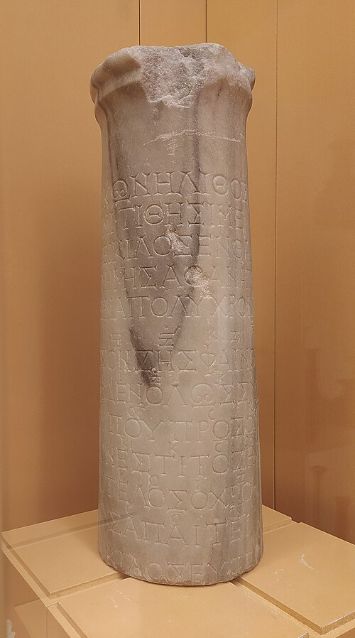
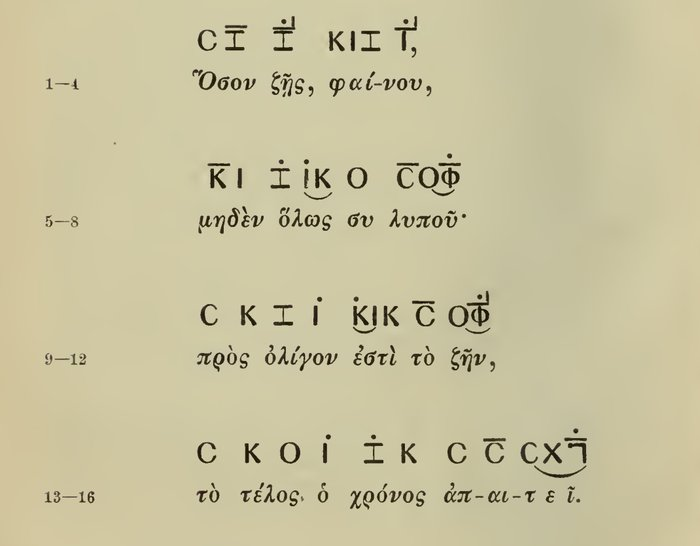

In 1883 a short marble column turned up near Aydın in western Turkey, the site of the Greek city of Tralles, while a railway was being built there under an engineer, Edward Purser. The archaeologist **[William Mitchell Ramsay](kloom:e/william-mitchell-ramsay)** printed its inscription that year in the _Bulletin de correspondance hellénique_. (Karl von Jan's edition of 1899 says that Ramsay found it; the classicist **[Armand D'Angour](kloom:e/armand-dangour)** has it come to light in Purser's works.) Under a two-line verse ran a song of four short verses, and over their syllables stood small letters and marks that no one recognized as music until 1891, when Otto Crusius suggested in print that they were notes. The **[Seikilos epitaph](kloom:e/seikilos-epitaph)** is the oldest complete song to survive with a tune we can read.

## A stone that sings

The stone speaks first, in an elegiac couplet: "I am an image and a stone; Seikilos sets me up here, a long-lasting marker of undying memory," in D'Angour's translation. Then it sings. The Greek, and our translation:

> ὅσον ζῇς, φαίνου, / μηδὲν ὅλως σὺ λυποῦ· / πρὸς ὀλίγον ἔστι τὸ ζῆν, / τὸ τέλος ὁ χρόνος ἀπαιτεῖ.
>
> While you live, shine; / let nothing grieve you at all. / Life lasts only a little while, / and time claims its due.

Purser's wife wanted it as a stand for her flowerpots, and its foot was sawn flat, cutting away the last line; a paper squeeze taken earlier keeps part of it, "Seikilos Euter…" and _zēi_, "lives." In 1922, during the burning of Smyrna, the Dutch consul carried it off to The Hague. In 1966 it was acquired by the **[National Museum of Denmark](kloom:e/national-museum-of-denmark)** in Copenhagen, where it is shown today.

_Zēi_ was a gravestone's formula, saying that the one who set it up still lived; hence "epitaph," and a dead wife named Euterpe. D'Angour reads the stone differently: as a monument that Seikilos, whose name means "the Sicilian," raised to his own song, signing himself the child of Euterpe, the Muse of lyric poetry. Its letters are dated by one authority to the first century AD and by Egert Pöhlmann and **[Martin West](kloom:e/martin-litchfield-west)** to the second.

## Letters for notes

Over each syllable stands a letter, some of them turned on their side: a pitch, not a sound of speech. A short bar over a letter, the _diseme_, makes the note last two beats; a bar with a stroke rising from its end, the _triseme_, three; a bare letter lasts one. Dots, _stigmai_, mark the second half of each bar, and what they meant, an upbeat or a stress, is still argued. Here is the first line as Jan printed it, with the notes in the usual modern equivalents (the pitch itself is not known):

| Syllable | Sign               | Note   | Beats     |
| -------- | ------------------ | ------ | --------- |
| hó-      | C                  | A      | 1         |
| -son     | Z, diseme          | E      | 2         |
| zêis     | Z, triseme, stigmē | E      | 3         |
| phaí-    | K I Z              | C♯ D E | 1 + 1 + 1 |
| -nou     | I, triseme, stigmē | D      | 3         |

Every line is twelve beats, two bars of six. Sung, the song opens low and short on A, leaps a fifth to E for "-son" and holds it, then holds it longer on _zêis_, "you live"; _phaí-_ climbs C♯, D, E in three quick steps, and "-nou" settles on D. The melody also follows the pitch accents of the words: in most of them the accented syllable is sung higher than the one after it, and the circumflex syllables of _lypoû_ and _zên_ fall over two notes, the last of _apaiteî_ over three. "All this cannot be accidental," wrote D. B. Monro in 1894. The last word falls from A through F♯ to E, the song's lowest note, heard only there. That final sign was long taken for a meaningless "3," until J. A. R. Munro of Oxford examined it afresh from a squeeze and read a reversed gamma, the sign for E; Monro printed the correction in a note at the end of his book.

## Alypius's tables

How does a C mean A? Through **[Alypius of Alexandria](kloom:e/alypius-of-alexandria)**, a writer of the fourth century AD whose _Introduction to Music_ is almost nothing but tables: for each of fifteen keys in three genera, every note's name with two signs, one for the voice and one for an instrument. The song uses the signs of his Iastian key, in the diatonic genus. There the note called the _mesē_, the middle, is omicron for the singer and kappa for the player; the stone's C is the note below it, and the reversed gamma lies three steps lower again. A His Master's Voice 78 of 1952 has the soprano Arda Mandikian singing it unaccompanied.

## Older, but broken

Almost every other piece of ancient Greek music is a fragment. The two **[Delphic Hymns](kloom:e/delphic-hymns)** to Apollo, cut into the wall of the Athenians' treasury at Delphi and found by French excavators in 1893, were long dated 138 and 128 BC; recent work puts both at 128 BC. Three hymns by **[Mesomedes](kloom:e/mesomedes)**, a Cretan poet and lyre-singer freed by the emperor **[Hadrian](kloom:e/hadrian)**, came down in Byzantine manuscripts and were printed by **[Vincenzo Galilei](kloom:e/vincenzo-galilei)** in 1581; until the stone, they were all the ancient music anyone had. The **[Oxyrhynchus hymn](kloom:e/oxyrhynchus-hymn)**, on a papyrus of the late third century AD found in Egypt in 1918, is the earliest Christian song with its notes. Far older than any of them, the **[Hurrian Hymn no. 6](kloom:e/hurrian-songs)** from Ugarit is nearly whole on its tablet, but no one agrees how to play its notation. Seikilos's is the oldest complete song whose tune can be read with confidence.

What reached the Latin Middle Ages was not the Greeks' songs but their theory, carried there by Boethius.
