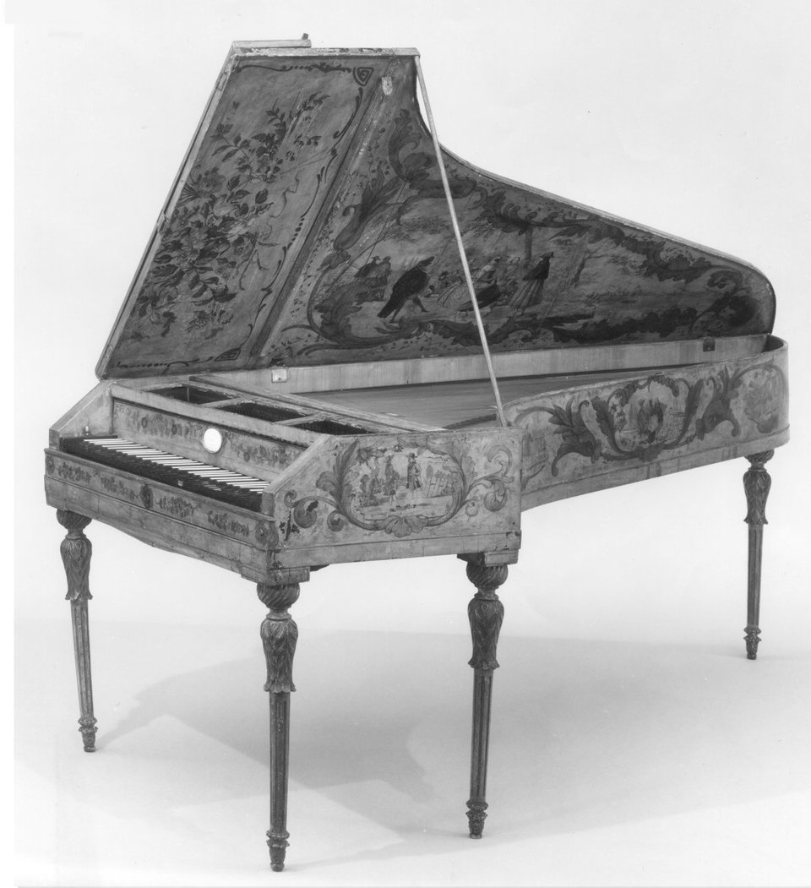
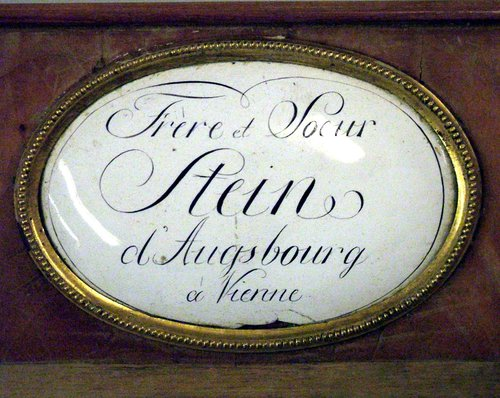

In October 1777 **[Wolfgang Amadeus Mozart](kloom:e/wolfgang-amadeus-mozart)**, 21 years old and looking for a post, stopped in **[Augsburg](kloom:e/augsburg)** with his mother on the way to Mannheim and Paris. He went to see the town's keyboard maker, **[Johann Andreas Stein](kloom:e/johann-andreas-stein)**, an organ builder's son from the Palatinate who had worked as a journeyman in 1748–49 in the Strasbourg shop of Johann Andreas Silbermann, Gottfried Silbermann's nephew, and in **[Franz Jakob Späth](kloom:e/franz-jakob-spath)**'s in Regensburg. By the 1770s Stein had left organs for clavichords, harpsichords and pianos. On 17 October Mozart wrote to his father, **[Leopold Mozart](kloom:e/leopold-mozart)**, a letter quoted by every history of the piano since. In Lady Wallace's translation of 1866:

> I must now tell you about the Stein pianos. Before seeing these, Spath's pianos were my favorites; but I must own that I give the preference to those of Stein, for they damp much better than those in Ratisbon. If I strike hard, whether I let my fingers rest on the notes or lift them, the tone dies away at the same instant that it is heard. Strike the keys as I choose, the tone always remains even, never either jarring or failing to sound. It is true that a piano of this kind is not to be had for less than three hundred florins, but the pains and skill which Stein bestows on them cannot be sufficiently repaid. His instruments have a feature of their own; they are supplied with a peculiar escapement. Not one in a hundred makers attends to this; but, without it, it is impossible that a piano should not buzz and jar.

What Mozart heard was a note that stopped when it should. On a piano without an escapement the hammer is pushed against the string and stays there, or bounces back and hits again, and the note buzzes; the dampers of a poor piano leave a ring behind. On Stein's, the hammer touched the string and fell away at once, the damper stopped the sound cleanly, and the knee lever that lifted the dampers, he added, needed only a touch, and "as soon as the pressure is removed not the slightest vibration is perceptible."

## The Viennese action

The action Stein is famous for, the _Prellmechanik_ or German action, is known from his pianos of 1780 and later. Each hammer rides on its own key, in a small fork near the key's far end, with its head pointing back toward the player. Behind its pivot the hammer has a short hook, the beak. When the key goes down, its far end rises and carries the hammer up; the beak catches under a sprung hopper fixed to the frame behind the keys, and the catch flips the hammer's head up against the string. The hopper is hinged, so the beak slips past it as the key returns. The plate draws it in section, beside the English action that London's makers built from Cristofori's.

|                  | Viennese action (Stein, from about 1780)          | English action (Backers, Broadwood, Stodart)           |
| ---------------- | ------------------------------------------------- | ------------------------------------------------------ |
| Hammer           | on the key, in a fork; head toward the player     | on a separate rail; head away from the player          |
| Escapement       | the hammer's beak caught by a hopper on the frame | a sprung jack in the key, tripped just before the blow |
| Strings per note | two                                               | three                                                  |
| Touch            | light and shallow                                 | deeper and heavier                                     |
| Sound            | delicate, quick to speak and to stop              | louder and fuller                                      |

How light? The scholar Edwin Ripin estimated that a key on a Viennese **[fortepiano](kloom:e/fortepiano)**, as such early pianos are now called, needs about a quarter of the force of a modern piano's, and goes down about half as far. In the pianist **[Sigismond Thalberg](kloom:e/sigismond-thalberg)**'s report on the **[Great Exhibition](kloom:e/great-exhibition)** of 1851, as Edward Rimbault printed it, the English action "gave a more powerful blow, and produced a fuller and finer tone, while the lightness of touch of the Vienna action afforded far greater facilities of expression."

## What Mozart praised

The letter is less certain evidence than it looks. The oldest Stein piano with the German action dates from 1780, three years after Mozart's visit, and the only earlier Stein piano known, part of a combined piano and harpsichord of 1777 now in Verona, has a different action, though one with an escapement too; it may have been that kind that Mozart played. The organologist Michael Latcham has suggested that parts of the letter read as if Stein dictated them for Leopold's benefit, among them the claim that Stein left his soundboards out "to rain, snow, sun, and every kind of devilry" until they cracked: surviving Stein soundboards show no such repairs.

## Stein's daughter

The same letter mocks Stein's eight-year-old daughter, Nannette, who sat at the treble end "that she may have more room to throw herself about and make grimaces." She became the firm. **[Nannette Streicher](kloom:e/nannette-streicher)**, as she was after her marriage to the musician Andreas Streicher, ran the workshop as her father failed and after his death in 1792, and in 1794 moved it to Vienna with her brother Matthäus. Their pianos were signed "Frère et Sœur Stein" until the two parted in 1802, and hers then "Nannette Streicher née Stein." By 1807 she had turned her father's five-octave piano into a grand of six and a half octaves, and the firm built 50 to 65 grand pianos a year. She was a friend of **[Ludwig van Beethoven](kloom:e/ludwig-van-beethoven)**, and for eighteen months from 1817 she ran much of his household for him, in more than sixty letters.

Beethoven also owned an English piano. In 1817 Thomas Broadwood of **[John Broadwood & Sons](kloom:e/john-broadwood-and-sons)** in London gave him a six-octave grand, which he kept until he died; Franz Liszt owned it later. The next frame in this trail goes to Paris and London, where Sébastien Érard set out to join the Viennese touch to the English blow.
