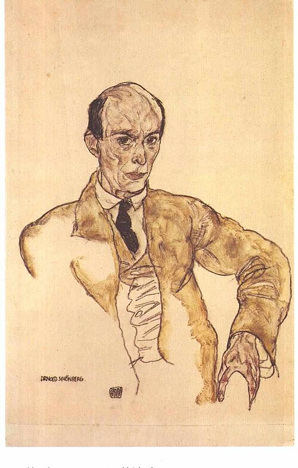

In July 1921, at a summer house in Traunkirchen, **[Arnold Schoenberg](kloom:e/arnold-schoenberg)** worked on the Prelude and Intermezzo of a suite for piano. He wrote to Alma Mahler that month that he had found "something completely new." His pupil Josef Rufer later remembered him saying that he had made a discovery which would ensure "the supremacy of German music for the next hundred years," though how closely Rufer recalled the words is disputed. In 1923, at home in Mödling outside **[Vienna](kloom:e/vienna)**, he began to explain it to his pupils: a "method of composing with twelve tones which are related only with one another." The **[Suite for Piano](kloom:e/suite-for-piano-schoenberg)**, Op. 25, finished that year, was the first work he built entirely on it.

## Music without a key

Schoenberg had left keys behind thirteen years before. In the last two movements of his Second String Quartet (1907–08) a soprano joins the four strings to sing poems by Stefan George, and the finale sets the words "Ich fühle luft von anderem planeten," "I feel air from another planet." It has no key signature at all. In **[_Pierrot lunaire_](kloom:e/pierrot-lunaire)** (1912), twenty-one poems for a reciter and five players, the voice does something else again: _Sprechstimme_, marked with small crosses on the note stems, touches each written pitch and slides away from it, half speech and half song.

Vienna answered with fists. At the **[Skandalkonzert](kloom:e/skandalkonzert)** in the Musikverein on 31 March 1913, Schoenberg conducted works by himself and his pupils. During two songs by **[Alban Berg](kloom:e/alban-berg)**, to picture-postcard texts by Peter Altenberg, people called for the poet and the composer to be locked in an asylum, fighting broke out, and the concert ended before Mahler's _Kindertotenlieder_ could be played. An organizer was sued for slapping a concertgoer; the operetta composer Oscar Straus testified that the slap had been the most harmonious sound of the evening. Two months later Paris heard **Igor Stravinsky**'s _Rite of Spring_.

## The row

Free atonality had no rule for what comes next. The **[twelve-tone technique](kloom:e/twelve-tone-technique)** gave it one. The composer orders all twelve notes of the octave into a row, none repeated, and every melody and chord in the piece is taken from that order. The row can be played backwards (the retrograde, R), upside down, each interval turned the other way (the inversion, I), or both (RI), and any of the four forms may start on any of the twelve notes: forty-eight forms in all. Here is the row of Op. 25 and the eight forms the Suite uses:

| Form           | Notes                             |
| -------------- | --------------------------------- |
| Prime, P0      | E F G D♭ G♭ E♭ A♭ D B C A B♭      |
| Retrograde, R0 | B♭ A C B D A♭ E♭ G♭ D♭ G F E      |
| Inversion, I0  | E E♭ D♭ G D F C G♭ A A♭ B B♭      |
| RI0            | B♭ B A♭ A G♭ C F D G D♭ E♭ E      |
| P6             | B♭ B D♭ G C A D A♭ F G♭ E♭ E      |
| I6             | B♭ A G D♭ A♭ B G♭ C E♭ D F E      |
| R6 and RI6     | P6 and I6 read from right to left |

Arnold Whittall pointed out that the third and fourth notes are G and D♭, the tritone, in all four of the Suite's forward forms. By our arithmetic, since the row ends a tritone from where it starts, these eight forms lie around the edge of the row's twelve-by-twelve table, which the plate draws. The row's last four notes, B C A B♭, are in German H C A B: Bach's name spelled backwards. The six movements are a Baroque suite's, a Prelude, Gavotte, Musette, Intermezzo, Minuet and Gigue, so what a listener hears is old dance rhythms carrying wide-leaping, keyless lines.

The four forms make a small piece of mathematics. Doing R twice, or I twice, gets you back where you began, and R then I is RI: the four combine as the **[Klein four-group](kloom:e/klein-four-group)**, named by Felix Klein in 1884, as Milton Babbitt observed in 1960. In 1919 **[Josef Matthias Hauer](kloom:e/josef-matthias-hauer)**, also in Vienna, had published his own "law of the twelve tones," and some histories credit him with the method first.

## From Vienna to Los Angeles

Berg and **[Anton Webern](kloom:e/anton-webern)**, who had studied with Schoenberg since 1904, took up the method; with him they are called the **[Second Viennese School](kloom:e/second-viennese-school)**. In 1925 Schoenberg was appointed in Berlin to teach the master class in composition at the **[Prussian Academy of Arts](kloom:e/prussian-academy-of-arts)**. In 1933 the new government of **[Nazi Germany](kloom:e/nazi-germany)** ordered "non-Aryan" officials out of state posts by a law of 7 April, and the Academy dismissed him under it. He had already left for Paris, where in July he returned to the Jewish faith. The Academy's file keeps a copy of his letter rejecting the dismissal as unlawful, and its correspondence in 1934 over the salary still owed him; some accounts say instead that he resigned before he could be put out. He reached the United States on 31 October 1933 to teach in Boston, and in 1934 moved to **[Los Angeles](kloom:e/los-angeles)**, where UCLA made him a professor in 1936 at $5,100 a year.

In May 1938 the Nazi Reich Music Days in Düsseldorf opened an exhibition of **[degenerate music](kloom:e/degenerate-music)** (_Entartete Musik_), organized by the theater director Hans Severus Ziegler, who blamed the "decay" of music on Judaism and capitalism. One of its seven sections was given to Schoenberg alone; Berg, Kurt Weill, Paul Hindemith and Stravinsky were pilloried too. Berg had died in 1935. Webern stayed in Austria; on 15 September 1945, at Mittersill, an American soldier sent to trap his son-in-law in black-market dealing shot him as he stood outside smoking.

After the war others went further. Babbitt from 1947, and Pierre Boulez and others in Europe, put durations and loudness into series as well as pitches, and in 1952, the year after Schoenberg died, Boulez titled an essay "Schoenberg is Dead": the young serialists took Webern as their model. Schoenberg's Los Angeles was meanwhile making a very different new sound: the electric guitar.
