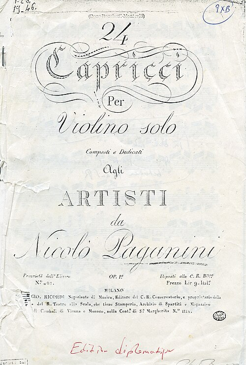

On 29 March 1828 **[Niccolò Paganini](kloom:e/niccolo-paganini)**, a gaunt violinist of 45 from Genoa, gave his first concert in **[Vienna](kloom:e/vienna)**, and the city lost its head. Everything was _à la Paganini_, as his biographer **[François-Joseph Fétis](kloom:e/francois-joseph-fetis)** put it: hats, gloves and shoes took his name, cooks named dishes after him, his bust topped fashionable men's walking sticks, and the emperor made him a virtuoso of the court. For a generation the hero of a concert was its performer, and the performers learned from Paganini how to be one.

## Four strings

Paganini had published what he could do in 1820: Ricordi of Milan printed his **[24 Caprices](kloom:e/24-caprices-for-solo-violin-paganini)** for violin alone, Op. 1, "composed and dedicated to the artists," an enigma, Fétis wrote, that "perplexed every violinist." Fétis listed what audiences heard: harmonic notes, single and double; plucking and bowing at once; strings retuned; leaps of wide intervals with "unerring precision." The plate draws the first of these on a violin's G string.

| Technique           | What the player does                                                   | What is heard                                                  | Where                                          |
| ------------------- | ---------------------------------------------------------------------- | -------------------------------------------------------------- | ---------------------------------------------- |
| Natural harmonics   | Touches the string lightly at a half, a third, a quarter of its length | A pure, whistling note an octave, a twelfth, two octaves above | Fétis: three octaves from the G string alone   |
| Left-hand pizzicato | Plucks with the fingers that are stopping the notes                    | Plucked notes among bowed ones, with no break                  | Caprice No. 24                                 |
| Ricochet            | Lets the bow bounce across all four strings                            | Chords broken into rapid, glittering arpeggios                 | Caprice No. 1                                  |
| Scordatura          | Tunes every string a semitone high                                     | The solo part, written in D, sounds in E-flat                  | Violin Concerto No. 1, its orchestra in E-flat |

Caprice No. 24, the best known, is a short theme in A minor, then eleven variations and a finale that run through the set's techniques: fast scales and arpeggios, octaves and tenths, left-hand pizzicato.

## The devil at his elbow

Rumors followed him: that he had learned to play in a prison cell, after murdering a mistress or a rival, and that his genius was the devil's. In 1831 a print shop on the Boulevard des Italiens sold a lithograph of him behind bars, and Paganini answered in the _Revue musicale_, in a letter Fétis wrote up for him. In Vienna, he wrote, a man had seen "the devil at my elbow directing my arm and guiding my bow," clothed in red, with horns; the prisoner story, he wrote, had grown from a violinist named Duranowski, jailed in Milan in 1798 for a plot to murder a rich priest. In Prague he printed a letter from his mother. When he died at Nice in 1840 the Church refused his body burial, and it was not buried until 1876. He left a fortune that Fétis put at two million francs.

## A piano Paganini

In April 1832 the pianist **[Franz Liszt](kloom:e/franz-liszt)**, aged twenty, heard Paganini in **[Paris](kloom:e/paris)**. "What a man, what a violin, what an artist!" he wrote to a friend in Geneva on 2 May. "Heavens! what sufferings, what misery, what tortures in those four strings!" He practiced for hours a day, and in 1838 published six studies after Paganini's caprices, which ask the pianist to stretch an eleventh; his revision of 1851, the **[Grandes études de Paganini](kloom:e/grandes-etudes-de-paganini)**, keeps to a tenth. Its third, "La campanella," the little bell, makes the right hand leap two octaves, again and again, a sixteenth note apart, to strike the bell's high note, a tune Paganini had given to a real handbell in his Second Violin Concerto. Leopold Godowsky recorded it for Columbia in 1913. Liszt also arranged Beethoven's symphonies and Schubert's songs for the piano and played them where no orchestra could.

In 1839, in Rome, he tried something new, writing on 4 June to Princess Belgiojoso of the "tiresome musical soliloquies (I do not know what other name to give to this invention of mine)": "I have ventured to give a series of concerts all by myself." The program was an overture, a fantasia, études and an improvisation, "by the same to the same!" In London on 9 June 1840, at the [Hanover Square Rooms](kloom:e/hanover-square-rooms), such concerts were first called recitals, and Liszt played them from memory.

## Lisztomania

The crowds began in Berlin at the end of 1841, and in 1841–44 Liszt gave an average of 66 concerts a year in Germany. Women fought over his gloves, handkerchiefs and cigar stubs, and made his broken piano strings into bracelets; Steinway's iron frame, on the piano trail, tells how pianos came to be built to stand such playing. In Paris on 25 April 1844 **[Heinrich Heine](kloom:e/heinrich-heine)** called it **[Lisztomania](kloom:e/lisztomania)**. He had taken it, he wrote, "for a sign of the want of political liberty beyond the Rhine," but then saw Paris do the same: "a delirium unparalleled in the annals of furore!" Its cause belonged "rather to the province of pathology than to that of aesthetics," unless it was that "nobody in the world knows how to organise 'successes'" as Liszt did. He also gave money away: when the **[Beethoven Monument](kloom:e/beethoven-monument)** in Bonn was failing in 1839, the French had given it less than 425 francs, and Liszt alone gave more than 10,000.

## Clara Schumann

**[Clara Schumann](kloom:e/clara-schumann)**, born Clara Wieck in Leipzig in 1819, gave her first public concert at nine and in 1838, after a winter of recitals in Vienna, was named the Austrian court's chamber virtuoso. She played from memory from the age of thirteen, which reviewers noted as exceptional. She married **[Robert Schumann](kloom:e/robert-schumann)** in 1840, bore eight children, and kept her family by touring until 1891. More than 1,300 of her printed programs survive. Reinhard Kopiez, Andreas Lehmann and Janina Klassen counted her concerts from them, and her life shows in the count:

| Years     | Her life                             | Concerts a season |
| --------- | ------------------------------------ | ----------------: |
| 1828–1840 | A prodigy, touring with her father   |              17.0 |
| 1840–1854 | Married, eight children              |              10.4 |
| 1854–1875 | Robert in an asylum, then widowed    |              36.7 |
| 1875–1891 | Arm pain, then teaching in Frankfurt |              12.0 |

She played the music she thought would last: four composers, her husband, Mendelssohn, Beethoven and Chopin, made up 70 percent of her performances, and Liszt was not among them. The next frame leaves the performer for a composer who built his own theater, at Bayreuth.
