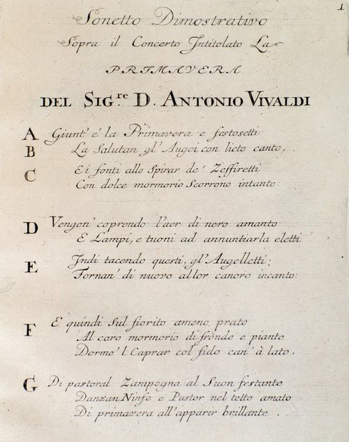

In 1725 the Amsterdam publisher Michel-Charles Le Cène printed twelve violin concertos by a Venetian priest, **[Antonio Vivaldi](kloom:e/antonio-vivaldi)**, under the title **[_Il cimento dell'armonia e dell'inventione_](kloom:e/il-cimento-dellarmonia-e-dellinventione)**, "the contest between harmony and invention". The first four were **[_The Four Seasons_](kloom:e/the-four-seasons-vivaldi)**, and each came with a sonnet. Capital letters set beside the poem's lines key them to passages of the music, and the parts carry words over the bars that play them: here the birds, here the storm, here the sleeping goatherd's dog. The concertos were older than the book, written around 1718–23, while Vivaldi worked for the court at Mantua, or perhaps a little earlier.

## The red priest and the Pietà

Vivaldi was born in **[Venice](kloom:e/venice)** in 1678 and ordained in 1703, and for his red hair he was called _il Prete Rosso_, the red priest. That September he became master of the violin at the **[Ospedale della Pietà](kloom:e/ospedale-della-pieta)**, one of four charitable houses in the city that took in children who had been abandoned or orphaned or whose families could not keep them. Infants were passed in through the _scaffetta_, a window too small for anything larger. Boys learned a trade and left at fifteen. Girls with talent were trained in music, and the best of them, the _figlie di coro_, sang and played in the chapel behind a metal grille, as nuns did, while visitors from across Europe listened. The Pietà's orchestra numbered up to sixty.

The French magistrate **[Charles de Brosses](kloom:e/charles-de-brosses)** heard them in August 1739. The four houses were made up, he wrote, of girls "bastard or orphaned", raised at the state's expense "and trained solely to excel in music. And so they sing like angels, and play the violin, the flute, the organ, the oboe, the cello, the bassoon". Each concert had about forty of them, and of the four the Pietà was "the first for the perfection of the orchestral music" (in our translation). He named its violinist Chiaretta as perhaps the first violin in Italy, unless she was surpassed by **[Anna Maria](kloom:e/anna-maria-della-pieta)**, whom he placed at another house. Anna Maria had been left at the Pietà as an infant in 1696; Vivaldi taught her, wrote many concertos for her, and by 1737 she led its violins and its choir. She stayed there all her life.

The Pietà paid for what it used. From 1723 Vivaldi owed it two concertos a month, at a sequin each, and rehearsals when he was in Venice; its books record 140 concertos in ten years. Of Vivaldi himself de Brosses wrote that he "has made himself one of my intimate friends, in order to sell me concertos very dear", and that he was less admired in Venice than he deserved, "where everything is fashion".

## Solo against band

A **[concerto](kloom:e/concerto)** sets a soloist against the whole band, the _tutti_, in three movements, fast, slow and fast. Vivaldi's fast movements turn on a **[ritornello](kloom:e/ritornello)**, a "little return": the tutti plays a theme, the soloist breaks away with an episode of its own, and the theme comes back, often shortened and in another key, between each episode. The plate shows Spring's first movement this way. Its eighty-two bars hold five ritornellos, by José Rodríguez Alvira's count, and the solo episodes between them are the poem's.

| Letter | The sonnet's line, in our translation                                   | What the music does                          |
| ------ | ----------------------------------------------------------------------- | -------------------------------------------- |
| A      | Spring has come                                                         | The tutti's ritornello in E major, bars 1–13 |
| B      | the birds greet it with happy song                                      | Solo violins in trills over held notes       |
| C      | and the springs, at the breath of the breezes, flow with a sweet murmur | Running sixteenth notes                      |
| D      | thunder and lightning, chosen to announce it                            | The storm, turning the music toward C♯ minor |
| E      | the birds return to their singing                                       | The birdsong again, now in the minor         |

So the dog is a sound in the score. In the slow movement, while the goatherd sleeps under rustling leaves, the violas bark for the dog, their part marked "the barking dog". Summer has its languor in the heat, and Autumn's peasants, drunk on the harvest wine, fall asleep. This is **[program music](kloom:e/program-music)**, instrumental music that tells a scene, more than a century before Franz Liszt coined the term; whether the sonnets came before the music or after, and whether Vivaldi wrote them, is not known.

## Forgotten and found

**[Johann Sebastian Bach](kloom:e/johann-sebastian-bach)** copied Vivaldi into his own music: he arranged six of his concertos for solo keyboard, three for organ, and one for four violins as a concerto for four harpsichords. Vivaldi left Venice for **[Vienna](kloom:e/vienna)**, perhaps to stage operas, and died there poor in the night of 27–28 July 1741. His funeral cost 19 florins and 45 kreuzer, and no music was performed.

Then he went quiet. In 1926 fourteen bound volumes of his manuscripts turned up in a monastery in Piedmont, with more in the family of their former owners; two Turin businessmen paid for them to go to the **[Turin National University Library](kloom:e/turin-national-university-library)**, in memory of their sons. They held some 300 concertos and 19 operas. _The Four Seasons_ was recorded in Italy in 1942, and in the last week of 1947 the American violinist **[Louis Kaufman](kloom:e/louis-kaufman)** recorded it at Carnegie Hall, days before a recording ban; that record was elected to the Grammy Hall of Fame in 2002. By 2011 there were about a thousand recordings. The next frame crosses to London, where Handel made a new kind of music out of the Bible.
