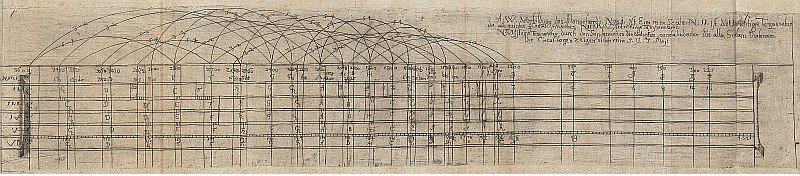

Twelve pure fifths, stacked one on another, overshoot seven octaves by a small, stubborn interval: the **[Pythagorean comma](kloom:e/pythagorean-comma)**, a ratio of 531441 to 524288, about a quarter of a semitone. A keyboard with twelve keys to the octave cannot keep every fifth pure and still close its circle. Meantone tuning had narrowed eleven fifths to sweeten the thirds and left the twelfth, the "wolf," far out of tune, which locked the player out of the keys around it. In 1691 the German organist **[Andreas Werckmeister](kloom:e/andreas-werckmeister)** published a book whose title promised something else: _Musicalische Temperatur_, "musical temperament," in our translation a "mathematical instruction" for tuning a clavier "so that, in the present manner, all the feigned modes" (the keys with many sharps and flats) could be heard "in a pleasant and tolerable harmony." The plan was to spread the comma among several fifths, unequally, so that no key was ruined and no two keys were quite alike. We now call it **[well temperament](kloom:e/well-temperament)**.

## Werckmeister's circle

Werckmeister, who had written a manual for testing new organs, the _Orgel-Probe_ of 1681, worked from a **[monochord](kloom:e/monochord)**, one string over a ruler, on which each tuning could be measured as lengths. The book came with the long engraved plate shown here, a monochord ruled for six tunings in rows. Row I was just intonation and row II quarter-comma meantone, the older tunings; rows III to VI were his own. The one now called **Werckmeister III**, the first of his "correct" temperaments, is the simplest. Go round the circle of fifths from C: the fifths C–G, G–D and D–A, and then B–F♯, are each narrowed by a quarter of the comma, and the other eight are left pure, 3 to 2.

| Fifth | In Werckmeister III | Ratio  |
| ----- | ------------------- | ------ |
| C–G   | ¼ comma narrow      | 1.4949 |
| G–D   | ¼ comma narrow      | 1.4949 |
| D–A   | ¼ comma narrow      | 1.4949 |
| A–E   | pure                | 1.5    |
| E–B   | pure                | 1.5    |
| B–F♯  | ¼ comma narrow      | 1.4949 |
| F♯–C♯ | pure                | 1.5    |
| C♯–G♯ | pure                | 1.5    |
| G♯–E♭ | pure                | 1.5    |
| E♭–B♭ | pure                | 1.5    |
| B♭–F  | pure                | 1.5    |
| F–C   | pure                | 1.5    |

Four quarters make one comma, so the circle closes on C. What it does to the thirds is the point. A pure major third is 5 to 4, or 1.25. In Werckmeister III the thirds come in four sizes, by our arithmetic from the tuning: on C and F, 1.2528, nearly pure; on D, G and B♭, 1.2571; on E♭, E, A and B, 1.2613; and on D♭, F♯ and A♭, 1.2656, the old Pythagorean 81 to 64. Heard, the difference is a beating. Held at middle C (taking it as 261.6 vibrations a second), C–E wavers about 3 times a second, a slow shimmer; the third on the D♭ just above beats about 17 times, a rough buzz. C major sounds calm and D♭ major tense, on one instrument, without retuning a string.

Werckmeister meant it. Of the harsh thirds he wrote, in J. Murray Barbour's translation, that it was better "the harshness be placed upon those that are used the least," and he declined equal temperament because he "would rather have the diatonic keys purer."

## Kirnberger, Vallotti, Young

Others drew the circle differently. **[Johann Kirnberger](kloom:e/johann-kirnberger)**, a pupil of Bach, printed one in his _Kunst des reinen Satzes_ that kept nearly every fifth pure and split a comma between D–A and A–E; a smoother one he described only in a letter, printed in 1871. **[Francesco Antonio Vallotti](kloom:e/francesco-antonio-vallotti)**, an Italian theorist, narrowed six consecutive fifths, F–C through E–B, and left six pure. The volume describing it stayed in manuscript until 1950, and the version now played under his name is a shifted form of one the English physician **[Thomas Young](kloom:e/thomas-young-scientist)** published in 1800.

## What did Bach use?

**[Johann Sebastian Bach](kloom:e/johann-sebastian-bach)** called his two books of preludes and fugues in all twenty-four keys, the first finished in 1722, _Das Wohltemperirte Clavier_: the **[_Well-Tempered Clavier_](kloom:e/the-well-tempered-clavier)**. In 1951 Barbour could write that "it is generally agreed that Bach tuned the clavier equally." Since then most scholars have argued for an unequal tuning, but no document says which.

In February and May 2005 the harpsichordist Bradley Lehman argued in _Early Music_ that Bach had drawn one. A looped flourish across the top of the 1722 title page, read upside down, was to him a tuning sequence: from F, five fifths narrowed by a sixth of the comma, three pure, three narrowed by a twelfth, and B♭–F a twelfth wide. That spring Goshen College in Indiana dedicated a new Taylor & Boody organ tuned his way. Replies filled the journal. In 2006 Mark Lindley and Ibo Ortgies called the premise that a strict scheme hid in a decorative scroll "daft," pointing to other ways of reading the same loops. J. R. Catch asked why Bach would keep such a code from his own pupils. The question is open, and the loops prove nothing on their own.

## The color of a key

In unequal tuning every key had its own color, and the century wrote it down. The poet and organist **[Christian Friedrich Daniel Schubart](kloom:e/christian-friedrich-daniel-schubart)**, whose _Ideen zu einer Ästhetik der Tonkunst_ was printed in 1806, after his death, began, in our translation: "Every key is either colored or uncolored." C major was "completely pure," its character "innocence, simplicity, naivety, the speech of children"; of E♭ minor he wrote, "If ghosts could speak, they would speak roughly in this key." Gentle, melancholy feelings went to the flat keys, wild and strong passions to the sharp ones; how much of that was tuning and how much habit, he did not say.

Bach's _Well-Tempered Clavier_, in the Baroque section, hears the forty-eight pieces themselves. The next frame on this trail asks why a beating third sounds rough at all.
