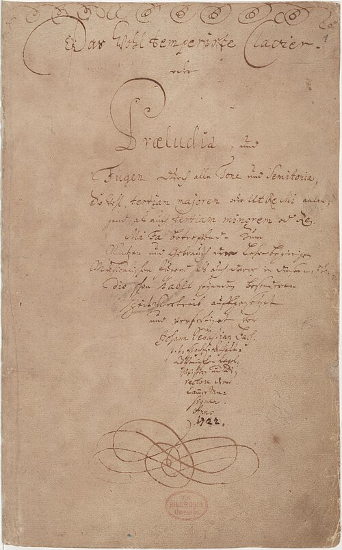

In 1722 **[Johann Sebastian Bach](kloom:e/johann-sebastian-bach)** was music director to a prince at a small court in central Germany, and he dated a manuscript of twenty-four preludes and twenty-four fugues for a keyboard. The court was **[Köthen](kloom:e/kothen)**, and on the title page he called himself the prince's "Capellmeister and Director of the Chamber Music". He named the book _Das Wohltemperirte Clavier_, the **[_Well-Tempered Clavier_](kloom:e/the-well-tempered-clavier)**: preludes and fugues "through all the tones and semitones", in every major key and every minor one. It was written, he said, "for the use and profit of musical youth eager to learn, and for the particular pastime of those already skilled in this study" (in our translation of his German). That manuscript is now in the Berlin State Library. Twenty years later, in Leipzig, he gathered a second book of the same plan, and the two together are often simply called "the Forty-Eight".

## A key for every pair

The book begins with a pair in C major, then C minor, then C♯ major and C♯ minor, and climbs a semitone at a time, major before minor, to B minor: twenty-four keys, each used once. Eleven of the preludes had begun in a little book of lessons Bach kept for his eldest son, Wilhelm Friedemann, in 1720. The first prelude is thirty-five bars of broken chords, one shape repeated twice in each bar, its harmony changing bar by bar and coming to rest on a single chord of C.

That plan asked something of the instrument. In the meantone tunings many keyboards still wore, a key with few sharps or flats sounded sweet and one with many sounded harsh. A book that wanders into F♯ major and B♭ minor needs every key usable, which is what "well-tempered" promised. Which tuning Bach meant, and whether it was equal temperament or something deliberately unequal, he never wrote down, and players and scholars still argue it; **[well temperament](kloom:e/well-temperament)** and its rival schemes have their own frame on the tuning trail.

## How a fugue works

A **[fugue](kloom:e/fugue)** is built from one short tune, the _subject_, that each voice takes up in turn. The first voice states it alone in the home key. A second voice answers it a fifth higher, in the key of the dominant, while the first goes on with a new line against it; when that line returns every time with the subject it is called a _countersubject_. When every voice has entered, that opening is the _exposition_. After it the subject comes back in other keys, often separated by _episodes_, passages built from its fragments that lead from one key to the next, and the entries may crowd together in _stretto_, a new voice starting before the last has finished.

The first fugue of the book is in four voices and twenty-seven bars. Its subject climbs step by step from C and ends in a quick turn of sixteenth notes. Frederick Iliffe's analysis of 1900 tabulates every entry; the first eight are these:

| Bar | Voice   | What enters        | Key |
| --- | ------- | ------------------ | --- |
| 1   | Alto    | Subject            | C   |
| 2   | Soprano | Answer             | G   |
| 4   | Tenor   | Answer             | G   |
| 5   | Bass    | Subject            | C   |
| 7   | Soprano | Subject            | C   |
| 7   | Tenor   | Answer, in stretto | G   |
| 9   | Alto    | Answer             | G   |
| 10  | Bass    | Subject            | G   |

It is an unusual first lesson. The voices enter subject, answer, answer, subject, and Iliffe counted no countersubject and not one episode: from the first bar to the last, the subject is almost never absent. It reaches A minor, D minor and F, and in bars 14 to 21 all four voices pile entries on top of one another three times over before a long C in the bass holds still under the last stretto and the close.

## A book passed hand to hand

The book was not printed in Bach's lifetime. It traveled in manuscript copies, made by pupils and by their pupils, until three publishers in Bonn, Leipzig and Zurich brought it out almost at once in 1801, fifty-one years after his death. By then it had already made two composers. In Vienna in April 1782 **[Wolfgang Amadeus Mozart](kloom:e/wolfgang-amadeus-mozart)** wrote to his father that he went every Sunday at noon to the house of **[Gottfried van Swieten](kloom:e/gottfried-van-swieten)**, "where nothing is played but Handel and Bach. I am now making a collection of the Bach fugues." He arranged five fugues from the second book for strings. In Bonn in March 1783 **[Christian Gottlob Neefe](kloom:e/christian-gottlob-neefe)** reported in a music magazine that his eleven-year-old pupil **[Ludwig van Beethoven](kloom:e/ludwig-van-beethoven)** "plays chiefly 'The Well-Tempered Clavichord' of Sebastian Bach, which Herr Neefe put into his hands."

The book's clavier meant any keyboard: the **[harpsichord](kloom:e/harpsichord)**, which plucks its strings; the **[clavichord](kloom:e/clavichord)**, too quiet for a hall, whose small metal tangents strike its strings and stay against them while the key is held; and the organ. The piano was new. According to Bach's pupil Johann Friedrich Agricola, when the organ builder **[Gottfried Silbermann](kloom:e/gottfried-silbermann)** showed Bach his first two pianos, Bach found the treble weak and the keys hard to play; Silbermann improved them until they won Bach's "complete approval", and in 1749 a receipt shows Bach acting as Silbermann's agent in selling one. **[Frederick the Great](kloom:e/frederick-the-great)** of Prussia bought several. Where Silbermann's action came from is the story of Cristofori's first piano.

The first complete recording came only in 1933–36, by the pianist Edwin Fischer for His Master's Voice, issued on 78 rpm discs to subscribers of its Bach Society: the disc that holds the F♯ minor prelude and fugue has the F♯ major pair on its other side. The next frame goes to Venice, to the concertos of Vivaldi that Bach arranged for the keyboard.
